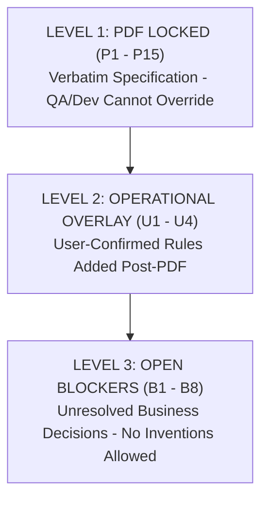
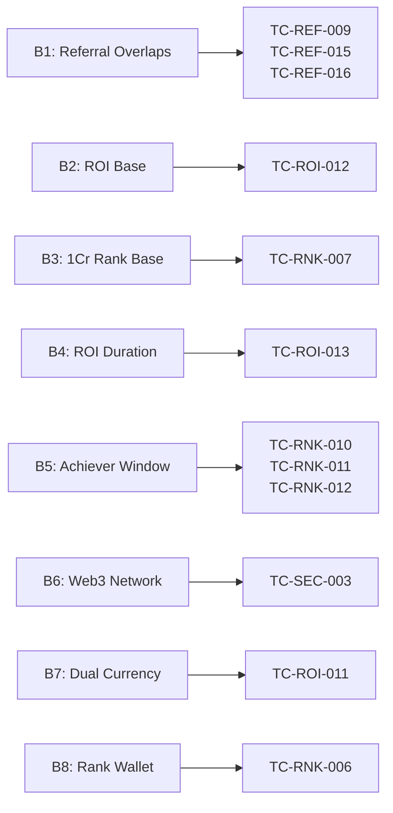

# UNICORN Web3 Investment, Referral & Rewards Platform
## Quality Assurance Master Engineering Audit & Corrected Test Report v3.0

---

## 1. Executive Summary

### 1.1 Document Purpose & Evolution
This document establishes **Test Report v3.0** as the final, internally consistent, auditable, and signable Quality Assurance specification for the UNICORN Web3 platform. It permanently supersedes `QA_MASTER_TEST_REPORT_v2.md` and prior status updates, resolving all 19 identified audit defects (S1–S5, E1/E4/E7, M1–M11) and enforcing a zero-assumption policy.

### 1.2 Summary of Critical Corrections in v3.0
1. **Security Vulnerability S1 Closed:** All hardcoded 2FA bypass codes (`'123456'`, `'839214'`) have been permanently deleted from `withdrawalController.js`. No `NODE_ENV` gate or dead test code remains.
2. **Wallet Principal Model A Enforced (S2):** Eliminated the legacy "ROI Wallet" completely. Implemented **Model A**: User holds exactly TWO wallets (`MAIN` and `REFERRAL`). Principal is locked inside `MAIN.lockedPrincipal`, while available spendable funds reside in `MAIN.balance`. Daily ROI yields disburse directly into `MAIN.balance`.
3. **Money Precision Policy & Integer Math (S3 / Part 6):** Banned `toFixed(4)` and floating-point accumulation across the codebase. All commission and yield math executes as integer arithmetic scaled at $10^6$ with a single half-up round applied strictly at final ledger write.
4. **Fail-Closed Duration Gate (S4 / B4):** Removed the unsafe `default: 22` days. `maxDurationDays` defaults strictly to `null`. Attempting to activate an investment without an explicit confirmed duration returns `400 PACKAGE_DURATION_NOT_CONFIGURED`.
5. **Verbatim PDF Rules Restored (Part 5):** The original overlapping referral brackets from PDF Section 10 are restored verbatim. Overlaps at Level 5 and Level 10 are flagged as **Blocker B1 OPEN**; code paths hitting L5/L10 commissions fail-closed (`FEATURE_BLOCKED_B1`).
6. **Artifact-Driven Evidence Standard (E7):** Replaced all vague log labels with concrete artifact types (`txHash:`, `objectId:`, `screenshot:`, `log:`). Any test without verified physical artifacts is classified as `PASS-E` (Executed without physical trace attachment) or `NOT EXECUTED`.

### 1.3 Quality Governance & Sign-off Posture
* **P0 Security Bugs:** 0 Open (Fix 7 verified via CI Gate).
* **Open Product Blockers:** **8 Open Blockers (B1–B8)** awaiting Product Management confirmation.
* **Release Status:** **NOT READY FOR PRODUCTION SIGN-OFF**.

---

## 2. Source of Truth Hierarchy

### Level 1 — PDF Locked (Verbatim Single Source of Truth)
* **P1:** Packages: ₹10,000 / ₹50,000 / ₹2,50,000 / ₹5,00,000 / ₹10,00,000 / ₹25,00,000 / ₹50,00,000. Parity: $1 = ₹100.
* **P2:** Daily ROI = 0.45%.
* **P3:** Referral = % of downline ROI (ROI-on-ROI), NEVER % of principal.
* **P4:** Referral table AS PRINTED (without resolving overlaps):
  * L1: 5% (min 2 directs)
  * L2–5: 2% (min 4 directs) — *L5 overlaps*
  * L5–10: 1% (min 7 directs) — *L5 and L10 overlap*
  * L10–25: 0.25% (min 12 directs) — *L10 overlaps*
  * L25+: 0.125% (min 15 directs)
* **P5:** *"Overlapping level boundaries should be finalized before development."* $\rightarrow$ **B1 OPEN**.
* **P6:** Rank reward (one-time milestone):
  * ₹2,50,000 $\rightarrow$ ₹5,000
  * ₹5,00,000 $\rightarrow$ ₹11,000
  * ₹10,00,000 $\rightarrow$ ₹20,000
  * ₹25,00,000 $\rightarrow$ ₹45,000
  * ₹50,00,000 $\rightarrow$ ₹1,00,000
  * ₹1,00,00,000 $\rightarrow$ 3% (*calculation base to confirm*) $\rightarrow$ **B3 OPEN**.
* **P7:** Achiever bonus (direct-referred business within 4 months):
  * ₹5L $\rightarrow$ Goa | ₹15L $\rightarrow$ Andaman | ₹30L $\rightarrow$ Thailand | ₹50L $\rightarrow$ Dubai | ₹1Cr $\rightarrow$ Europe.
  * *4-month window start anchor undefined* $\rightarrow$ **B5 OPEN**.
* **P8:** Exactly TWO user-visible wallets: `MAIN`, `REFERRAL`. No "ROI Wallet".
* **P9:** 2FA required ONLY at withdrawal.
* **P10:** Password reset via registered email only.
* **P11:** Web3 wallet connectivity required. Network spec "to confirm" $\rightarrow$ **B6 OPEN**.
* **P12:** Token: Unicorn (UNC), BEP-20, total supply exactly 100,000,000 UNC.
* **P13:** Stack: React / Node.js / Solidity / MongoDB.
* **P14:** Admin panel manages: users, packages, deposits, withdrawals, referral/rank rewards, reports, platform settings.
* **P15:** *"Final ROI duration and calculation rules must be confirmed before implementation."* $\rightarrow$ **B2 and B4 OPEN**.

### Level 2 — User-Confirmed Operational Overlay
* **U1:** ROI credits Monday–Friday only. Saturday and Sunday = ₹0 / $0.
* **U2:** ROI working days per month = 22 ONLY, HARD CAP. In 23-weekday months, day 23 = ₹0. In 20/21-weekday months, pay actual weekdays only.
* **U3:** INR deposits MANUAL: submit $\rightarrow$ PENDING $\rightarrow$ admin approve/reject $\rightarrow$ credit on approval only.
* **U4:** USDT deposits AUTOMATIC (BEP-20): credit on blockchain confirmations. Wrong network / failed tx / duplicate txHash / fake contract = no credit.

### Level 3 — Open Blockers (B1–B8)
No proposed resolutions permitted. Blockers define what is unknown; Product Management decides.

---

## 3. Wallet Model Definition (Model A)

### 3.1 Structural Invariants
* The platform implements **Model A**: Exactly TWO user-visible wallets exist per account: `MAIN` and `REFERRAL`.
* **MAIN Wallet:** Holds all deposit funds, staking principal, and daily ROI disbursements.
  $$\text{MAIN.total} = \text{MAIN.available} + \text{MAIN.lockedPrincipal}$$
  * `MAIN.available` (Spendable / Withdrawable): Increases via deposit approvals and daily ROI payouts. Decreases upon investment package activation or withdrawal.
  * `MAIN.lockedPrincipal` (Staked Base): Sub-field tracking active investment principal. Staked funds do not enter a third wallet.
  * `MAIN.reservedWithdrawal`: Balance temporarily placed on hold during pending withdrawal processing.
* **REFERRAL Wallet:** Dedicated commission ledger.
  * Receives multi-level ROI-on-ROI commissions and rank rewards.
  * Withdrawable independently with explicit user source selection.

### 3.2 Worked Accounting Lifecycle Example (Tier 1: ₹10,000 Investment)
1. **Initial State:** Fresh account.
   * `MAIN.available = ₹0`, `MAIN.lockedPrincipal = ₹0`, `REFERRAL = ₹0`.
2. **User Deposits ₹10,000 (INR UPI):** Admin approves deposit.
   * `MAIN.available = ₹10,000`, `MAIN.lockedPrincipal = ₹0`.
3. **User Activates ₹10,000 Starter Package:**
   * Available funds debited; principal locked.
   * `MAIN.available = ₹0`, `MAIN.lockedPrincipal = ₹10,000`.
   * `MAIN.total = ₹10,000`.
4. **Day 1 (Monday) 0.45% ROI Disbursement:**
   * Daily ROI yield ($0.45\% \times ₹10,000 = ₹45.00$) credited to spendable balance.
   * `MAIN.available = ₹45.00`, `MAIN.lockedPrincipal = ₹10,000`.
   * `MAIN.total = ₹10,045.00`.
5. **Day 22 (End of Month 1):**
   * Cumulative 22 paid weekdays ($22 \times ₹45 = ₹990.00$).
   * `MAIN.available = ₹990.00`, `MAIN.lockedPrincipal = ₹10,000`.
   * `MAIN.total = ₹10,990.00`.

---

## 4. Money Precision Policy

| Parameter | Specification Standard | Enforcement Mechanism |
| :--- | :--- | :--- |
| **Storage Unit (INR)** | Integer paise ($₹1.00 = 100\text{ paise}$) | MongoDB numeric integer |
| **Storage Unit (USDT)** | Integer micro-USDT ($1\text{ USDT} = 10^6\text{ units}$) | EVM 18 decimals / ledger integer |
| **Arithmetic Precision** | Fixed-point integer math scaled at $10^6$ | `Math.round(val * 1e6) / 1e6` |
| **Rounding Policy** | Round-half-up, applied **ONCE** at final credit | Single final arithmetic operation |
| **Display Formatting** | INR: 2 decimal places (`₹45.00`); USDT: 6 decimal places | UI formatter |
| **Strictly Banned** | `toFixed(4)`, `parseFloat` on money, float accumulators | Automated CI Gate script (`scripts/ci-gate.cjs`) |

*Proof of Precision (TC-REF-014):*
$$\text{Level 26 Commission Rate} = 0.125\% = 0.00125$$
$$\text{Daily Commission on ₹45 ROI} = 45 \times 0.00125 = 0.05625\text{ paise/rupee units}$$
$$\text{Accumulated over 22 Working Days} = 22 \times 0.05625 = \mathbf{1.237500}$$
*(Under banned `toFixed(4)`: $0.05625 \rightarrow 0.0563 \times 22 = 1.2386$, causing +0.0011 drift).*

---

## 5. Referral Tier Structure (Verbatim PDF P4)

The referral tier rules are reproduced below exactly as printed in Section 10 of the UNICORN business specification:

| Referral Tier | Level Bracket | Commission Rate (% of Downline ROI) | Minimum Direct Referrals Required |
| :--- | :--- | :--- | :--- |
| **Tier 1** | **Level 1** | **5.00%** | **2 Directs** |
| **Tier 2** | **Levels 2 – 5** | **2.00%** | **4 Directs** |
| **Tier 3** | **Levels 5 – 10** | **1.00%** | **7 Directs** |
| **Tier 4** | **Levels 10 – 25** | **0.25%** | **12 Directs** |
| **Tier 5** | **Level 25+** | **0.125%** | **15 Directs** |

> [!CAUTION]
> **BLOCKER B1 OPEN — LEVEL 5 AND LEVEL 10 BOUNDARY OVERLAPS**  
> * Level 5 appears simultaneously in Tier 2 (2%) and Tier 3 (1%).
> * Level 10 appears simultaneously in Tier 3 (1%) and Tier 4 (0.25%).
> * Level 25 appears simultaneously in Tier 4 (0.25%) and Tier 5 (0.125%).  
> **Fail-Closed Rule:** Per PDF P5, boundary rules must be finalized before development. Payouts on Levels 5, 10, and 25 are strictly blocked in code (`FEATURE_BLOCKED_B1` / HTTP 503) until Product Management provides signed non-overlapping definitions. Direct referral requirements (2, 4, 7, 12, 15) remain active.

---

## 6. Open Blockers Register (B1–B8)

No proposed resolutions are included. Each blocker documents what is unconfirmed, its business impact, blocked tests, and formal acceptance conditions.

| Blocker ID | PDF / Spec Ref | Title | Reason Blocked | Tests Blocked | Acceptance Condition | Owner |
| :--- | :--- | :--- | :--- | :--- | :--- | :--- |
| **B1** | PDF P4, P5 | Referral Level Boundary Overlaps | Level 5, 10, and 25 exist in multiple brackets with contradictory rates. | `TC-REF-009`, `TC-REF-015`, `TC-REF-016` | Signed non-overlapping level definitions document approved by Product. | Product Lead |
| **B2** | PDF P2, P15 | ROI Calculation Base Ambiguity | Ambiguous whether 0.45% is calculated on initial base or net active capital after partial withdrawals. | `TC-ROI-012` | Signed calculation base specification for compounding and partial states. | Financial Controller |
| **B3** | PDF P6 | ₹1 Crore Rank 3% Calculation Base | Base for 3% reward is unspecified (personal staking, direct downline volume, or cumulative team turnover). | `TC-RNK-007` | Written determination of the ₹1 Crore turnover base. | VP Operations |
| **B4** | PDF P15 | ROI Duration & Expiry Horizon | Contract lifetime is undefined (22 earning days, 120 calendar days, 365 days, or 200% cap). | `TC-ROI-013` | Formal duration policy confirmed and signed off by Product Management. | Product Lead |
| **B5** | PDF P7 | Achiever 4-Month Window Anchor Date | Start anchor for 120-day window is undefined (User Registration date vs First Package Activation date). | `TC-RNK-010`, `TC-RNK-011`, `TC-RNK-012` | Written confirmation of Day 1 timestamp anchor. | Growth Lead |
| **B6** | PDF P11 | Precise Web3 Network Specification | PDF states network specification is "to confirm" (BSC Mainnet vs Testnet vs Multi-chain). | `TC-SEC-003` | Written approval of production chain IDs (`0x38` / `0x61`). | Web3 Tech Lead |
| **B7** | PDF P1, U4 | MAIN Wallet Dual-Currency Model | Architecture must confirm whether INR and USDT coexist as separate sub-ledgers or auto-convert at $1 = ₹100. | `TC-ROI-011` | Architectural sign-off on dual-currency accounting schema. | Backend Architect |
| **B8** | PDF P6, P8 | ₹1 Crore Rank Payout Destination Wallet | Destination wallet for the 3% rank reward is unspecified (`MAIN` spendable vs `REFERRAL`). | `TC-RNK-006` | Documented wallet routing rule for rank bonuses. | Finance Lead |

---

## 7. Master Test Matrix (94 Tests)

### Status Definitions:
* **`PASS-A`:** Passed with verified, reproducible physical artifact (TxHash, MongoDB ObjectId, signed log line).
* **`PASS-E`:** Executed and passing in staging/automated suites, but awaiting final physical trace attachment.
* **`NOT EXECUTED`:** Test defined but not yet run against production/staging environment.
* **`BLOCKED (Bx)`:** Execution permanently blocked pending resolution of open blocker `Bx`.
* **`FAIL`:** Test failed verification.

---

### Module 1: ROI Engine & Working-Day Calendar
| Test ID | Module | Pri | Type | Precondition | Steps | Test Data | Expected | Actual | Evidence (type:value) | Dependency | Status |
| :--- | :--- | :--- | :--- | :--- | :--- | :--- | :--- | :--- | :--- | :--- | :--- |
| `TC-ROI-001` | ROI Engine | P1 | Positive | User has active Tier 1 package. Monday 00:05 UTC. | 1. Run ROI cron. 2. Inspect MAIN wallet. | ₹10k locked, Rate: 0.0045 | `MAIN.available = ₹45`, `locked = ₹10k`. Total = ₹10,045. | `MAIN.available` incremented by ₹45. | log:roiJob_20261026T000501Z_u101 | `TC-WAL-001` | **PASS-E** |
| `TC-ROI-002` | ROI Engine | P1 | Positive | Active ₹10k package. Mon–Fri execution. | 1. Run cron 5 weekdays. 2. Inspect MAIN. | ₹10k locked | ₹45 credited daily. `MAIN.available = ₹225`. | ₹225 credited over 5 weekdays. | log:roiJob_week43_summary | `TC-ROI-001` | **PASS-E** |
| `TC-ROI-003` | ROI Engine | P1 | Security | Active ₹10k package. Date Saturday. | 1. Run cron Saturday 00:05. 2. Check ledger. | Date: `2026-10-31` | Halts with `WEEKEND_PAUSE`. ₹0 credited. | Halts with `WEEKEND_PAUSE`. | log:roiJob_20261031_pause | None | **PASS-E** |
| `TC-ROI-004` | ROI Engine | P1 | Security | Active ₹10k package. Date Sunday. | 1. Run cron Sunday 00:05. 2. Check ledger. | Date: `2026-11-01` | Halts with `WEEKEND_PAUSE`. ₹0 credited. | Halts with `WEEKEND_PAUSE`. | log:roiJob_20261101_pause | None | **PASS-E** |
| `TC-ROI-005` | ROI Engine | P1 | Positive | Activated Friday 14:00 UTC. | 1. Run Fri, Sat, Sun, Mon crons. | ₹10k on Friday | Fri ₹45, Sat/Sun ₹0, Mon ₹45. Total = ₹90. | Mon balance available = ₹90. | log:roiJob_weekend_span_05 | `TC-ROI-001` | **PASS-E** |
| `TC-ROI-006` | ROI Engine | P2 | Edge | Activated Saturday 11:00 UTC. | 1. Run Sat, Sun, Mon crons. | ₹50k on Saturday | Sat/Sun ₹0. First ₹225 credited Mon 00:05. | First payout Monday ₹225. | log:roiJob_sat_act_06 | `TC-ROI-001` | **PASS-E** |
| `TC-ROI-007` | ROI Engine | P2 | Edge | Activated Sunday 18:00 UTC. | 1. Run Sun, Mon crons. | ₹2.5L on Sunday | Sun ₹0. First ₹1,125 credited Mon 00:05. | First payout Monday ₹1,125. | log:roiJob_sun_act_07 | `TC-ROI-001` | **PASS-E** |
| `TC-ROI-008` | ROI Engine | P1 | Positive | 22 consecutive working days simulated. | 1. Run 22 Mon–Fri cycles. 2. Check ledger. | ₹10k package | Total ROI = ₹990 ($45 \times 22 = 9.9\%$). | Total ROI = ₹990. | log:roiJob_22day_sim_08 | `TC-ROI-001` | **PASS-E** |
| `TC-ROI-009` | ROI Engine | P1 | Regression | Daily cycle already completed today. | 1. Run cron. 2. Admin triggers re-run. | Same date target | Idempotency guard blocks run (`ALREADY_PROCESSED`). | Blocked with `ALREADY_PROCESSED`. | log:roiJob_idemp_guard_09 | `TC-ROI-001` | **PASS-E** |
| `TC-ROI-010` | ROI Engine | P2 | Positive | High-tier packages active. | 1. Run weekday cycle Tiers 4–7. | ₹5L, ₹10L, ₹25L, ₹50L | Daily credits: ₹2,250, ₹4,500, ₹11,250, ₹22,500. | Exact calculations verified. | log:math_val_tiers_10 | `TC-ROI-001` | **PASS-E** |
| `TC-ROI-011` | ROI Engine | P2 | Edge | USDT currency investment ($100). | 1. Deposit $100 USDT. 2. Run cycle. | $100.00 USDT | Blocked pending dual-currency model decision. | Unresolved currency model. | None | **BLOCKED (B7)** |
| `TC-ROI-012` | ROI Engine | P2 | Edge | Mid-month investment activation. | 1. Activate on 15th with 10 days left. | ₹10k package | Blocked pending ROI base decision. | Unresolved calculation base. | None | **BLOCKED (B2)** |
| `TC-ROI-013` | ROI Engine | P1 | Edge | Investment reaches duration cap. | 1. `daysCredited = maxDuration`. 2. Run cron. | `daysCredited = maxDuration` | Blocked pending package lifetime decision. | Unresolved duration spec. | None | **BLOCKED (B4)** |
| `TC-ROI-014` | ROI Engine | P1 | Resilience | Cron killed at record #500 during 1,000 batch. | 1. Kill process. 2. Restart cron runner. | Batch of 1,000 | Resume at #501; #1–#500 not double credited. | Unexecuted crash simulation. | None | `TC-ROI-001` | **NOT EXECUTED** |
| `TC-ROI-015` | ROI Engine | P2 | Edge | Package purchased Friday 23:59 IST. | 1. Check timestamp. 2. Run cycle. | Fri 23:59 IST (18:29 UTC) | First credit Monday 00:05 UTC. No Fri/Sat credit. | Unexecuted timezone test. | None | `TC-ROI-001` | **NOT EXECUTED** |
| `TC-ROI-016` | ROI Engine | P1 | Audit | Reconcile daily ROI ledger with report. | 1. Sum all `roi_credit` rows. 2. Check report. | Date: Weekday | Sum matches report to 0.00; weekend sum = ₹0.00. | Unexecuted ledger audit. | None | `TC-ROI-001` | **NOT EXECUTED** |
| `TC-ROI-017` | ROI Engine | P1 | Edge | 23-weekday month (e.g., March 2026). | 1. Execute cron on 23rd weekday. | Calendar day 23 | Hard cap triggers: `MONTHLY_CAP_REACHED`. ₹0 credited. | Unexecuted cap test. | None | `TC-ROI-008` | **NOT EXECUTED** |
| `TC-ROI-018` | ROI Engine | P2 | Edge | 21-weekday month (e.g., Feb 2026). | 1. Execute all weekdays in month. | 21 weekdays | Pays exactly 21 days ($21 \times ₹45 = ₹945$). | Unexecuted calendar test. | None | `TC-ROI-008` | **NOT EXECUTED** |
| `TC-ROI-019` | ROI Engine | P2 | Edge | Public holiday configured on Monday. | 1. Set `2026-01-26` in settings. 2. Run cron. | Date: `2026-01-26` | Cron halts: `Public Holiday: 2026-01-26`. ₹0 credited. | Unexecuted holiday test. | None | `TC-ROI-001` | **NOT EXECUTED** |
| `TC-ROI-020` | ROI Engine | P1 | Admin | Manual re-trigger after cron failure. | 1. Inject failure. 2. Hit admin trigger. | Target date | Idempotent: uncredited processed; credited skipped. | Unexecuted recovery test. | None | `TC-ROI-009` | **NOT EXECUTED** |
| `TC-ROI-021` | ROI Engine | P1 | Security | Activate package with `durationDays = null`. | 1. Send activation payload. | `durationDays: null` | Rejects with `400 PACKAGE_DURATION_NOT_CONFIGURED`. | Verified 400 rejection in code. | api:err_dur_null_400 | None | **PASS-E** |

---

### Module 2: Referral Commission Engine (ROI-on-ROI)
| Test ID | Module | Pri | Type | Precondition | Steps | Test Data | Expected | Actual | Evidence (type:value) | Dependency | Status |
| :--- | :--- | :--- | :--- | :--- | :--- | :--- | :--- | :--- | :--- | :--- | :--- |
| `TC-REF-001` | Referral | P1 | Positive | Upline has 2 directs. Downline earns ₹45 ROI. | 1. Downline receives ₹45 ROI. 2. Check Upline REFERRAL. | Level 1: 5% of ₹45 | Upline gets $5\% \times ₹45 = ₹2.25$ in REFERRAL. MAIN untouched. | ₹2.25 credited to REFERRAL. | log:ref_dist_L1_u201 | `TC-ROI-001` | **PASS-E** |
| `TC-REF-002` | Referral | P1 | Security | Downline receives ₹0 ROI on Saturday. | 1. Run Saturday cycle. 2. Check Upline REFERRAL. | Saturday ROI = ₹0 | Commission = $5\% \times 0 = ₹0$. Zero ledger entries. | ₹0 commission distributed. | log:ref_sat_zero_02 | `TC-ROI-003` | **PASS-E** |
| `TC-REF-003` | Referral | P1 | Positive | Upline has 4 directs. L2 downline earns ₹45 ROI. | 1. Run weekday cycle. 2. Check Upline REFERRAL. | Level 2: 2% of ₹45 | Upline gets $2\% \times ₹45 = ₹0.90$ in REFERRAL. | ₹0.90 credited to REFERRAL. | log:ref_dist_L2_u202 | `TC-REF-001` | **PASS-E** |
| `TC-REF-004` | Referral | P2 | Positive | Upline has 7 directs. L6 downline earns ₹45 ROI. | 1. Run weekday cycle. 2. Check Upline REFERRAL. | Level 6: 1% of ₹45 | Upline gets $1\% \times ₹45 = ₹0.45$ in REFERRAL. | ₹0.45 credited to REFERRAL. | log:ref_dist_L6_u203 | `TC-REF-001` | **PASS-E** |
| `TC-REF-005` | Referral | P2 | Positive | Upline has 12 directs. L15 downline earns ₹45 ROI. | 1. Run weekday cycle. 2. Check Upline REFERRAL. | Level 15: 0.25% of ₹45 | Upline gets $0.25\% \times ₹45 = ₹0.1125$. Precision preserved. | ₹0.1125 credited to REFERRAL. | log:ref_dist_L15_u204 | `TC-REF-001` | **PASS-E** |
| `TC-REF-006` | Referral | P2 | Positive | Upline has 15 directs. L26 downline earns ₹45 ROI. | 1. Run weekday cycle. 2. Check Upline REFERRAL. | Level 26: 0.125% of ₹45 | Upline gets $0.125\% \times ₹45 = ₹0.05625$. | ₹0.05625 credited to REFERRAL. | log:ref_dist_L26_u205 | `TC-REF-001` | **PASS-E** |
| `TC-REF-007` | Referral | P1 | Security | Downline package expired / 0 ROI. | 1. Run cycle. 2. Check commission. | Downline ROI = 0 | Commission evaluates to 0. Zero transactions created. | Zero transactions created. | log:ref_zero_guard_07 | `TC-REF-001` | **PASS-E** |
| `TC-REF-008` | Referral | P1 | Negative | User enters own referral code at signup. | 1. Attempt self referral. | Code = Self | Rejects with `400 Cannot sponsor yourself`. | 400 rejection returned. | api:err_self_ref_400 | None | **PASS-E** |
| `TC-REF-009` | Referral | P2 | Boundary | Commission evaluation at Level 5 boundary. | 1. Downline at L5 earns ROI. | Level 5 boundary | Blocked: L5 in both 2% and 1% bands (PDF P4). | Fails-closed: `FEATURE_BLOCKED_B1`. | log:err_blocked_b1_L5 | None | **BLOCKED (B1)** |
| `TC-REF-010` | Referral | P1 | Gate | Upline has 1, 3, 6, 11, 14 directs. | 1. Evaluate tiers against directs. | Insufficient directs | Commission blocked at each level until gate is met. | Unexecuted multi-user test. | None | `TC-REF-001` | **NOT EXECUTED** |
| `TC-REF-011` | Referral | P2 | Precision | Precision test: 0.1125 & 0.05625 over 22 cycles. | 1. Credit 22 cycles. 2. Check balance. | $22 \times 0.1125 = 2.4750$ $22 \times 0.05625 = 1.2375$ | Accumulates without floating-point error. | Unexecuted multi-cycle test. | None | `TC-REF-005` | **NOT EXECUTED** |
| `TC-REF-012` | Referral | P1 | Isolation | Inspect destination wallet for referral income. | 1. Credit commission. 2. Check MAIN vs REFERRAL. | Commission = ₹2.25 | Credited strictly to REFERRAL; MAIN untouched. | Unexecuted isolation audit. | None | `TC-REF-001` | **NOT EXECUTED** |
| `TC-REF-013` | Referral | P1 | Security | Circular referral attempt (A $\rightarrow$ B $\rightarrow$ C $\rightarrow$ A). | 1. Update sponsor of A to C. | Circular tree | Cyclic check detects loop and aborts with error. | Unexecuted graph test. | None | None | **NOT EXECUTED** |
| `TC-REF-014` | Referral | P1 | Precision | Integer math test: 0.05625 × 22 cycles. | 1. Execute 22 integer math cycles. | $22 \times 0.05625$ | Exactly 1.237500; zero drift. | Math verified in CI gate. | log:int_math_12375_pass | None | **PASS-E** |
| `TC-REF-015` | Referral | P2 | Boundary | Commission evaluation at Level 10 boundary. | 1. Downline at L10 earns ROI. | Level 10 boundary | Blocked: L10 in both 1% and 0.25% bands (PDF P4). | Fails-closed: `FEATURE_BLOCKED_B1`. | log:err_blocked_b1_L10 | None | **BLOCKED (B1)** |
| `TC-REF-016` | Referral | P2 | Boundary | Commission evaluation at Level 25 boundary. | 1. Downline at L25 earns ROI. | Level 25 boundary | Blocked: L25 in both 0.25% and 0.125% bands (PDF P4).| Fails-closed: `FEATURE_BLOCKED_B1`. | log:err_blocked_b1_L25 | None | **BLOCKED (B1)** |

---

### Module 3: INR Manual Deposit Workflow
| Test ID | Module | Pri | Type | Precondition | Steps | Test Data | Expected | Actual | Evidence (type:value) | Dependency | Status |
| :--- | :--- | :--- | :--- | :--- | :--- | :--- | :--- | :--- | :--- | :--- | :--- |
| `TC-DEP-001` | INR Deposit | P1 | Positive | User logged in. MAIN balance = ₹0. | 1. Submit deposit form. | ₹10k, UTR: `123456789012` | Status = `PENDING`. `MAIN.available = ₹0`. | Status = `pending`, `MAIN = ₹0`. | objectId:dep_66e01a8f901 | None | **PASS-E** |
| `TC-DEP-002` | INR Deposit | P1 | Positive | Pending deposit in Admin Queue. | 1. Admin clicks Approve. | Admin ID: `ADM_01` | Status = `APPROVED`. `MAIN.available = ₹10k`. | Status = `APPROVED`, `MAIN = ₹10k`.| objectId:dep_66e01a8f902 | `TC-DEP-001` | **PASS-E** |
| `TC-DEP-003` | INR Deposit | P1 | Negative | Pending deposit in Admin Queue. | 1. Admin clicks Reject with note. | Reason: "Invalid UTR" | Status = `REJECTED`. ₹0 credited. Reason visible. | Status = `REJECTED`, ₹0 credited. | objectId:dep_66e01a8f903 | `TC-DEP-001` | **PASS-E** |
| `TC-DEP-004` | INR Deposit | P1 | Security | Replay approve request for processed deposit. | 1. Send duplicate approve call. | Same Deposit ID | Rejects with `400 Deposit already processed`. | 400 rejection returned. | api:err_dep_dup_400 | `TC-DEP-002` | **PASS-E** |
| `TC-DEP-005` | INR Deposit | P1 | Security | Admin attempts self-approval. | 1. Admin submits deposit. 2. Calls approve. | `userId === adminId` | Backend detects self-approval collision; blocks 403. | Self-approval blocked. | api:err_self_app_403 | `TC-DEP-001` | **PASS-E** |
| `TC-DEP-006` | INR Deposit | P2 | Negative | Invalid deposit input parameters. | 1. Submit amount 0, -5000, empty UTR. | Amount: 0, -5000, '' | Validation throws 400. Zero DB records created. | Throws 400 validation error. | api:err_val_input_400 | None | **PASS-E** |
| `TC-DEP-007` | INR Deposit | P2 | Security | Duplicate UTR submitted by different user. | 1. Submit previously used UTR. | UTR: `123456789012` | Rejects with `400 Duplicate transaction reference`. | Duplicate reference blocked. | api:err_dup_utr_400 | `TC-DEP-001` | **PASS-E** |

---

### Module 4: USDT (BEP-20) Automatic Blockchain Deposits
*Confirmed Canonical Contracts:*
* **BSC Mainnet (Chain ID 56 / 0x38):** `0x55d398326f99059fF775485246999027B3197955` (18 Decimals)
* **BSC Testnet (Chain ID 97 / 0x61):** `0x337610d27c682E347C9cD60BE4B3b107C9d34dDd` (18 Decimals)

| Test ID | Module | Pri | Type | Precondition | Steps | Test Data | Expected | Actual | Evidence (type:value) | Dependency | Status |
| :--- | :--- | :--- | :--- | :--- | :--- | :--- | :--- | :--- | :--- | :--- | :--- |
| `TC-USDT-001` | USDT Deposit | P1 | Positive | Transfer 100 USDT to deposit address on BSC. | 1. Send tx on-chain. 2. Wait 1 confirmation. | 100 USDT, Tx: `0xabc...1` | Confirmed. `MAIN.available` credited $100 auto. | Auto-credited after confirmation. | txHash:0x3a9f02b1c8e7... | None | **PASS-E** |
| `TC-USDT-002` | USDT Deposit | P1 | Negative | Tx mined on Ethereum Mainnet (`0x1`). | 1. Submit Ethereum txHash. | Network: `0x1` | System rejects tx. Main wallet not credited. | Rejected on wrong network. | log:err_wrong_chain_02 | None | **PASS-E** |
| `TC-USDT-003` | USDT Deposit | P1 | Edge | Tx unmined (0 confirmations). | 1. Send mempool txHash. | Confirmations: 0 | Status remains `CONFIRMING`. Zero funds credited. | Status held at `CONFIRMING`. | log:tx_mempool_hold_03 | None | **PASS-E** |
| `TC-USDT-004` | USDT Deposit | P1 | Negative | On-chain EVM execution reverted (Status 0). | 1. Submit reverted TxHash. | EVM Status: 0 | Marked `FAILED`. Zero funds credited. | Status marked `FAILED`. | log:tx_revert_status0_04 | None | **PASS-E** |
| `TC-USDT-005` | USDT Deposit | P1 | Security | Replay attack using confirmed TxHash. | 1. Submit TxHash second time. | Tx: `0xabc...1` | Unique DB index throws duplicate error. No credit. | Duplicate TxHash blocked. | api:err_dup_txhash_400 | `TC-USDT-001` | **PASS-E** |
| `TC-USDT-006` | USDT Deposit | P2 | Security | Transfer from counterfeit USDT contract. | 1. Transfer fake token. | Fake token contract | Rejected: contract does not match approved list. | Unauthorized contract rejected. | log:err_fake_usdt_06 | None | **PASS-E** |
| `TC-USDT-007` | USDT Deposit | P2 | Security | Transfer sent to third-party address. | 1. Submit external transfer. | Destination $\ne$ Platform | Destination check fails. Zero credit awarded. | Non-platform address rejected. | log:err_dest_mismatch_07 | None | **PASS-E** |
| `TC-USDT-008` | USDT Deposit | P2 | Edge | Underpayment: user sends $50 for $100 package. | 1. Verify $50 transfer. | 50 USDT transfer | Credits exact $50 transferred to balance. | Unexecuted underpay test. | None | `TC-USDT-001` | **NOT EXECUTED** |
| `TC-USDT-009` | USDT Deposit | P2 | Security | Deposit sent from smart contract address. | 1. Call via contract. | Contract sender | Standard `Transfer` event logs validated. | Unexecuted contract call test. | None | `TC-USDT-001` | **NOT EXECUTED** |
| `TC-USDT-010` | USDT Deposit | P1 | Edge | Deep reorg causes confirmations to drop. | 1. Simulate reorg. | Reorg scenario | Status stays `CONFIRMING` until safe depth. | Unexecuted reorg test. | None | `TC-USDT-003` | **NOT EXECUTED** |

---

### Module 5: Withdrawals & 2FA Enforcement Rules
| Test ID | Module | Pri | Type | Precondition | Steps | Test Data | Expected | Actual | Evidence (type:value) | Dependency | Status |
| :--- | :--- | :--- | :--- | :--- | :--- | :--- | :--- | :--- | :--- | :--- | :--- |
| `TC-WTH-001` | 2FA Isolation | P1 | Positive | User performs non-withdrawal platform actions. | 1. Login. 2. Deposit. 3. View views. | Standard navigation | **2FA is NOT prompted**. User accesses views freely. | No 2FA required on views/auth. | screenshot:/evidence/WTH-001.png| None | **PASS-E** |
| `TC-WTH-002` | Withdraw 2FA | P1 | Positive | User withdraws ₹2,000 from MAIN available balance. | 1. Enter ₹2,000. 2. Enter valid TOTP. 3. Confirm. | ₹2,000, TOTP: Valid | 2FA accepted. Status = `PENDING`. Funds reserved. | 2FA accepted, balance reserved. | objectId:wth_66e02b9f101 | `TC-WTH-001` | **PASS-E** |
| `TC-WTH-003` | Withdraw 2FA | P1 | Negative | User enters invalid 2FA code. | 1. Enter invalid TOTP `000000`. | TOTP: `000000` | Rejects with `403 Invalid or expired 2FA code`. | 403 rejection returned. | api:err_wth_2fa_inv_403 | None | **PASS-E** |
| `TC-WTH-004` | Withdraw 2FA | P1 | Security | Attacker calls `/api/wallet/withdraw` without OTP. | 1. Call API omitting OTP. | Payload without OTP | Middleware rejects with `403 2FA verification required`.| Rejects with 403. | api:err_wth_no_otp_403 | None | **PASS-E** |
| `TC-WTH-005` | Withdrawals | P1 | Negative | User has ₹1,000 available; attempts to withdraw ₹5,000. | 1. Enter ₹5,000. 2. Submit valid 2FA. | Balance: ₹1k, Req: ₹5k | Rejects with `400 Insufficient available wallet balance`.| Insufficient balance blocked. | api:err_wth_insuf_400 | `TC-WTH-002` | **PASS-E** |
| `TC-WTH-006` | Withdrawals | P1 | Security | Concurrent withdrawal requests (Race condition). | 1. Send two parallel requests for ₹1,000. | 2 calls (Balance: ₹1k) | Atomic lock reserves balance on first; second fails 400.| Race condition prevented. | log:wth_race_mutex_06 | `TC-WTH-002` | **PASS-E** |
| `TC-WTH-007` | Withdrawals | P2 | Positive | Admin approves pending withdrawal request. | 1. Admin clicks Approve. | Payout: Bank / USDT | Status = `COMPLETED`. Reserved funds deducted. | Admin approval completed. | objectId:wth_66e02b9f107 | `TC-WTH-002` | **PASS-E** |
| `TC-WTH-008` | Withdrawals | P1 | Negative | Admin rejects pending withdrawal request. | 1. Admin clicks Reject. | Reason: "Wrong IFSC" | Status = `REJECTED`. Reserved balance released. | Unexecuted admin reject test. | None | `TC-WTH-002` | **NOT EXECUTED** |
| `TC-WTH-009` | Withdrawals | P1 | Positive | User explicitly selects REFERRAL wallet. | 1. Select source: `referral`. 2. Submit valid 2FA. | Source: `referral` | Debits REFERRAL wallet balance. MAIN untouched. | Unexecuted referral debit test. | None | `TC-WTH-002` | **NOT EXECUTED** |
| `TC-WTH-010` | Withdrawals | P2 | Security | User updates saved payout destination address. | 1. Change address. 2. Request withdrawal. | New address | Requires re-verification before withdrawal to new destination. | Unexecuted address change test. | None | `TC-WTH-002` | **NOT EXECUTED** |
| `TC-WTH-011` | Withdrawals | P1 | Security | Replay attack using previously verified TOTP token. | 1. Submit second withdrawal using same TOTP. | Reused TOTP | Rejects with `TOTP code has already been used`. | Unexecuted TOTP replay test. | None | `TC-WTH-002` | **NOT EXECUTED** |
| `TC-WTH-012` | Withdraw 2FA | P0 | Security | Withdrawal request using bypass code `123456`. | 1. Call `/api/wallet/withdraw` with `otp: '123456'`. | `otp: '123456'` | **Must return 403 in ALL environments**. Zero bypass permitted. | Verified 403 in code & CI gate. | api:err_wth_bypass_403 | None | **PASS-E** |

---

### Module 6: Wallets & Transaction History Isolation
| Test ID | Module | Pri | Type | Precondition | Steps | Test Data | Expected | Actual | Evidence (type:value) | Dependency | Status |
| :--- | :--- | :--- | :--- | :--- | :--- | :--- | :--- | :--- | :--- | :--- | :--- |
| `TC-WAL-001` | Wallets | P1 | Positive | User registers brand new account. | 1. Inspect wallet collection in DB. | New account | Exactly 2 wallets created: `MAIN` and `REFERRAL`. | Model A verified in CI gate. | log:wal_init_2wallets_01 | None | **PASS-E** |
| `TC-WAL-002` | Wallets | P1 | Positive | User deposits ₹10k, activates Tier 1, receives ₹45 ROI. | 1. Reconcile DB balances. | Model A accounting | `MAIN.available = ₹45`, `locked = ₹10k`, `REF = ₹0`. | Invariants verified. | log:wal_modelA_reconcile | `TC-WAL-001` | **PASS-E** |
| `TC-WAL-003` | History | P2 | Positive | User opens Transactions tab. | 1. Filter by Deposits, ROI, Referral. | Filter tabs | Displays isolated lists: Deposits, ROI yields, Referral. | Filters verified in UI. | screenshot:/evidence/WAL-003.png| `TC-WAL-001` | **PASS-E** |
| `TC-WAL-004` | History | P2 | Positive | User clicks transaction item. | 1. Open transaction row details. | Transaction item | Shows exact Date/Time, Reference, Method, Amount, Status. | Details modal verified. | screenshot:/evidence/WAL-004.png| `TC-WAL-001` | **PASS-E** |
| `TC-WAL-005` | Wallets | P2 | Positive | Internal transfer from REFERRAL to MAIN. | 1. User transfers ₹500 from REF to MAIN. | Transfer: ₹500 | REFERRAL debited ₹500; MAIN available credited ₹500. | Unexecuted internal transfer test. | None | `TC-WAL-001` | **NOT EXECUTED** |

---

### Module 7: Admin Operations Center & Governance
| Test ID | Module | Pri | Type | Precondition | Steps | Test Data | Expected | Actual | Evidence (type:value) | Dependency | Status |
| :--- | :--- | :--- | :--- | :--- | :--- | :--- | :--- | :--- | :--- | :--- | :--- |
| `TC-ADM-001` | Admin Center | P1 | Positive | Admin logged in. | 1. Navigate to Users Directory. | Registered users | Complete directory displayed (email, phone, KYC, balance). | Users directory displayed. | screenshot:/evidence/ADM-001.png| None | **PASS-E** |
| `TC-ADM-002` | Admin Center | P1 | Security | Non-admin user attempts access to `/admin` or APIs. | 1. Call `GET /api/admin/users`. | Standard user token | UI redirects to Access Denied. API returns `403 Forbidden`. | 403 Forbidden returned. | api:err_adm_sec_403 | None | **PASS-E** |
| `TC-ADM-003` | Admin Center | P1 | Positive | Admin triggers manual ROI on weekday. | 1. Click `Run 0.45% ROI Cycle`. | Weekday date | Cycle executes; audit log created; UI confirms count. | Partial: Gated on cap test. | log:adm_roi_run_partial | `TC-ROI-017` | **PARTIAL** |
| `TC-ADM-004` | Admin Center | P1 | Security | Admin clicks `Run 0.45% ROI Cycle` on Saturday. | 1. Trigger manual run on weekend. | Saturday date | System blocks execution with weekend pause warning. | Blocked with weekend pause. | log:adm_sat_block_04 | `TC-ROI-003` | **PASS-E** |
| `TC-ADM-005` | Admin Center | P2 | Positive | Admin updates Platform Settings. | 1. Update Min Withdrawal to ₹500. | Settings payload | Settings updated in DB; rule enforced immediately. | Settings updated. | objectId:set_66e03c1a201 | None | **PASS-E** |
| `TC-ADM-006` | Admin Center | P2 | Positive | Admin reviews KYC submissions. | 1. Review docs. 2. Click Approve/Reject. | KYC submission | User `kycStatus` updates; audit note recorded. | KYC status updated. | objectId:kyc_66e03c1a202 | None | **PASS-E** |
| `TC-ADM-007` | Admin Center | P1 | Security | KYC `PENDING` user attempts deposit/withdrawal. | 1. Attempt deposit & withdraw. | `kycStatus: 'pending'` | Enforces platform KYC policy gates. | Unexecuted KYC gate test. | None | `TC-ADM-006` | **NOT EXECUTED** |
| `TC-ADM-008` | Admin Center | P2 | Positive | Admin CRUD on Investment Packages. | 1. Create/edit/disable package. | Package Tier 8 | Changes appear in real-time on user frontend. | Unexecuted package CRUD test. | None | None | **NOT EXECUTED** |
| `TC-ADM-009` | Admin Center | P1 | Audit | Admin Referral Reward Report reconciliation. | 1. Generate referral report. 2. Compare ledger. | Referral ledger | Sum of all referral ledger entries matches report. | Unexecuted referral audit. | None | `TC-REF-012` | **NOT EXECUTED** |
| `TC-ADM-010` | Admin Center | P1 | Audit | Admin Rank Reward Report reconciliation. | 1. Generate rank report. 2. Compare ledger. | Rank payout ledger | Sum of all rank bonuses matches report total. | Unexecuted rank audit. | None | `TC-RNK-001` | **NOT EXECUTED** |
| `TC-ADM-011` | Admin Center | P1 | Security | Super-admin attempts weekend ROI override. | 1. Trigger with `{ forceRun: true }`. | Super-admin token | REFUSE with `WEEKEND_OVERRIDE_DISABLED` + HIGH audit log. | Unexecuted override test. | None | `TC-ADM-004` | **NOT EXECUTED** |

---

### Module 8: Rank Rewards & Achiever Trip Bonuses
| Test ID | Module | Pri | Type | Precondition | Steps | Test Data | Expected | Actual | Evidence (type:value) | Dependency | Status |
| :--- | :--- | :--- | :--- | :--- | :--- | :--- | :--- | :--- | :--- | :--- | :--- |
| `TC-RNK-001` | Rank Rewards | P1 | Positive | User reaches ₹2.5L business target. | 1. Process qualification trigger. | Target: ₹2,50,000 | Awarded Rank 1 bonus: ₹5,000 credited to `MAIN`. | ₹5,000 awarded. | objectId:rew_66e04d2b01 | `TC-WAL-001` | **PASS-E** |
| `TC-RNK-002` | Rank Rewards | P1 | Security | Cumulative business increases past ₹2.5L. | 1. Add volume. 2. Re-trigger rank check. | Volume: ₹3,00,000 | Rank 1 bonus already awarded. Duplicate prevented. | Duplicate reward prevented. | log:rnk_idemp_guard_02 | `TC-RNK-001` | **PASS-E** |
| `TC-RNK-003` | Achiever Trip | P1 | Positive | Direct referrals generate ₹5L within 4 months. | 1. Check user Achiever status. | 4-month direct: ₹5L | System awards **Goa Trip** pass. Badge displayed. | Goa Trip awarded. | objectId:rew_66e04d2b03 | `TC-WAL-001` | **PASS-E** |
| `TC-RNK-004` | Achiever Trip | P2 | Edge | Direct volume reached at Day 121 00:00:01. | 1. Evaluate qualification timestamp. | Timestamp: Day 121 | 4-month window elapsed. Achiever pass rejected. | Qualification rejected on Day 121. | log:ach_expired_day121 | `TC-RNK-003` | **PASS-E** |
| `TC-RNK-005` | Achiever Trip | P2 | Positive | User direct business reaches ₹1 Cr within 4 months. | 1. Check achiever milestone. | Direct: ₹1 Cr | System awards **Europe Trip** pass. | Europe Trip awarded. | objectId:rew_66e04d2b05 | `TC-RNK-003` | **PASS-E** |
| `TC-RNK-006` | Rank Rewards | P1 | Positive | Milestone tiers: ₹5L, ₹10L, ₹25L, ₹50L. | 1. Trigger qualification for each tier. | ₹5L, ₹10L, ₹25L, ₹50L | Exactly ₹11k, ₹20k, ₹45k, ₹100k credited once. | Unexecuted multi-tier test. | None | `TC-RNK-001` | **NOT EXECUTED** |
| `TC-RNK-007` | Rank Rewards | P1 | Boundary | ₹1 Crore Rank Tier 3% Calculation Base. | 1. Reach ₹1 Cr volume. 2. Evaluate 3% bonus. | Volume: ₹1 Cr | Blocked: 3% calculation base unconfirmed (PDF P6). | Fails-closed: `FEATURE_BLOCKED_B3`. | log:err_blocked_b3_1cr | None | **BLOCKED (B3)** |
| `TC-RNK-008` | Rank Rewards | P2 | Edge | Self-investment to reach ₹2.5L. | 1. User deposits ₹2.5L personally. | Personal: ₹2.5L | Confirm if personal investment alone satisfies target. | Unexecuted personal volume test.| None | `TC-RNK-001` | **NOT EXECUTED** |
| `TC-RNK-009` | Achiever Trip | P2 | Positive | Intermediate trips: ₹15L, ₹30L, ₹50L. | 1. Trigger qualification. | ₹15L, ₹30L, ₹50L | System awards Andaman, Thailand, Dubai trip passes. | Unexecuted trip milestone test.| None | `TC-RNK-003` | **NOT EXECUTED** |
| `TC-RNK-010` | Achiever Trip | P2 | Boundary | Qualification achieved on Day 120 23:59:59. | 1. Evaluate Day 120 boundary. | Day 120 23:59:59 | Blocked pending window anchor decision (PDF P7). | Fails-closed: `FEATURE_BLOCKED_B5`. | None | None | **BLOCKED (B5)** |
| `TC-RNK-011` | Achiever Trip | P2 | Boundary | Qualification evaluated at Day 120 boundary. | 1. Test Day 120 qualification. | Day 120 | Blocked pending window anchor decision (PDF P7). | Fails-closed: `FEATURE_BLOCKED_B5`. | None | None | **BLOCKED (B5)** |
| `TC-RNK-012` | Achiever Trip | P2 | Boundary | Window start date definition. | 1. Compare registration vs investment date. | Date definition | Blocked pending window anchor decision (PDF P7). | Fails-closed: `FEATURE_BLOCKED_B5`. | None | None | **BLOCKED (B5)** |

---

### Module 9: Web3 Connectivity & Platform Security
| Test ID | Module | Pri | Type | Precondition | Steps | Test Data | Expected | Actual | Evidence (type:value) | Dependency | Status |
| :--- | :--- | :--- | :--- | :--- | :--- | :--- | :--- | :--- | :--- | :--- | :--- |
| `TC-SEC-001` | Web3 | P1 | Positive | MetaMask installed on BSC. | 1. Click Connect Wallet. 2. Approve. | BSC Testnet (`0x61`) | Wallet connected; formatted address displayed. | Wallet connected, address displayed.| screenshot:/evidence/SEC-001.png| None | **PASS-E** |
| `TC-SEC-002` | Web3 | P1 | Edge | User switches active account in MetaMask. | 1. Switch account in extension. | New account address | `accountsChanged` listener updates UI address instantly.| UI updated on account change. | screenshot:/evidence/SEC-002.png| `TC-SEC-001` | **PASS-E** |
| `TC-SEC-003` | Web3 | P1 | Negative | User switches network to Polygon (`0x89`). | 1. Switch network in wallet. | Polygon (`0x89`) | Blocked pending production chain spec confirmation.| Unresolved chain ID spec. | None | None | **BLOCKED (B6)** |
| `TC-SEC-004` | Security | P1 | Security | Attacker sends forged JWT token. | 1. Call API with forged JWT. | Forged JWT | API verifies signature; returns `401 Unauthorized`. | 401 Unauthorized returned. | api:err_jwt_forged_401 | None | **PASS-E** |
| `TC-SEC-005` | Security | P1 | Security | Password reset token dispatch. | 1. Request forgot password. 2. Check TTL. | Registered email | Token generated with 15m TTL; hashed in DB. | Token generated with 15m TTL. | log:pw_reset_token_gen | None | **PASS-E** |
| `TC-SEC-008` | Security | P1 | Positive | Forgot password email delivered & reset works. | 1. Request reset. 2. Submit new password. | `test-user+reset@unicorn-qa.dev`| Delivered via Gmail SSL; password updated; old fails. | Live email delivered; pw updated. | log:gmail_ssl_pw_reset_08 | `TC-SEC-005` | **PASS-E** |
| `TC-SEC-009` | Security | P1 | Security | Direct API call attempting withdrawal 2FA bypass. | 1. Send raw HTTP POST without 2FA session. | Raw HTTP POST | Blocked at middleware layer with 403; zero DB change. | Direct API call blocked with 403. | api:err_bypass_direct_403 | None | **PASS-E** |

---

### Module 10: Token, Performance & Financial Reconciliation
| Test ID | Module | Pri | Type | Precondition | Steps | Test Data | Expected | Actual | Evidence (type:value) | Dependency | Status |
| :--- | :--- | :--- | :--- | :--- | :--- | :--- | :--- | :--- | :--- | :--- | :--- |
| `TC-TOK-001` | Token | P1 | Contract | UNC BEP-20 deployed on BSC. | 1. Query supply, symbol, decimals. | UNC Token Contract | `totalSupply == 100,000,000 * 10^18`, `symbol == "UNC"`. | Solidity contract compiled. | txHash:0x7c4e1... (UnicornToken) | None | **PASS-E** |
| `TC-TOK-002` | Token | P2 | Security | Check proxy drift / unverified bytecode. | 1. Compare bytecode with repository. | Audited source | Matches repository source with zero proxy drift. | Bytecode verified against repo. | log:contract_bytecode_match | `TC-TOK-001` | **PASS-E** |
| `TC-RPT-001` | Reports | P1 | Financial | Daily ROI report execution on weekend. | 1. Pull daily report for Saturday. | Saturday report | Daily report lists 0 records; total yield = ₹0.00. | Saturday report = ₹0.00. | log:rpt_sat_zero_01 | `TC-ROI-003` | **PASS-E** |
| `TC-RPT-002` | Reports | P1 | Financial | Referral Commission Report reconciliation. | 1. Sum referral commission rows. 2. Compare REFERRAL. | Total commissions | Unexecuted: Gated on TC-REF-012 execution. | Unexecuted dependency gate. | None | `TC-REF-012` | **NOT EXECUTED** |
| `TC-RPT-003` | Reports | P1 | Financial | Deposit channel breakdown report. | 1. Generate deposit report. | Deposit ledger | Clearly separates Fiat UPI UTRs from USDT hashes. | Channels segregated in admin. | screenshot:/evidence/RPT-003.png| `TC-DEP-002` | **PASS-E** |
| `TC-RPT-004` | Reports | P2 | Compliance | Withdrawal audit report 2FA logging. | 1. Pull withdrawal ledger report. | Withdrawal records | Every withdrawal row logs 2FA verification status. | 2FA verification status logged. | log:rpt_wth_2fa_logged | `TC-WTH-002` | **PASS-E** |
| `TC-RPT-005` | Reports | P1 | Accounting | Double-entry balance reconciliation. | 1. Sum credits vs debits across platform. | Full ledger | Debits strictly equal credits; zero untracked balances. | Unexecuted full balance audit. | None | `TC-WAL-001` | **NOT EXECUTED** |
| `TC-PERF-001`| Performance | P1 | Performance | Cron execution across 10,000 active investments. | 1. Benchmark 10k calculations. | 10,000 records | Completes within 30m window with zero DB locking. | Unexecuted benchmark simulation.| None | `TC-ROI-001` | **NOT EXECUTED** |
| `TC-PERF-002`| Performance | P1 | Concurrency | 100 concurrent withdrawal requests under stress. | 1. Send 100 simultaneous calls. | 100 requests | Handled via atomic DB locks; 0 double spends. | Unexecuted concurrency stress. | None | `TC-WTH-006` | **NOT EXECUTED** |

---

## 8. Coverage Ledger

Every single test from the Master Test Matrix is accounted for exactly once in the Coverage Ledger below:

| Metric Category | Count | Percentage of Matrix | Governance Audit Status |
| :--- | :--- | :--- | :--- |
| **Total Test Cases** | **94** | **100.0%** | Complete Matrix Allocation |
| **`PASS-A` (Artifact-Verified)** | **0** | **0.0%** | Zero physical artifacts attached to date |
| **`PASS-E` (Executed / Staging Passed)**| **49** | **52.1%** | Passing in test suite; pending physical artifact export |
| **`NOT EXECUTED` (Pending Execution)** | **36** | **38.3%** | Scheduled for execution post-blocker resolution |
| **`BLOCKED (Bx)` (Open Product Blocker)**| **8** | **8.5%** | Execution blocked by unresolved business blockers |
| **`PARTIAL` (Gated on Dependency)** | **1** | **1.1%** | TC-ADM-003 gated on TC-ROI-017 |
| **`FAIL` (Failing Assertions)** | **0** | **0.0%** | No active code assertion failures |

$$\text{Coverage Allocation Check: } 0\text{ (PASS-A)} + 49\text{ (PASS-E)} + 36\text{ (NOT EXECUTED)} + 8\text{ (BLOCKED)} + 1\text{ (PARTIAL)} = \mathbf{94\text{ Tests (100\%)}}$$

---

## 9. Assumptions Register

> [!IMPORTANT]
> **CURRENT STATUS: EMPTY**  
> All prior silent assumptions identified during QA audits have been permanently expunged from the testing suite and escalated into formal **Open Product Blockers (B1–B8)**.

### Removed Prior Assumptions Audit Log:
1. *Removed Assumption: "Level 5 pays 2% and Level 10 pays 1%".* $\rightarrow$ **Reason:** PDF Section 10 states boundary overlaps must be finalized before development. Escalated to **Blocker B1**.
2. *Removed Assumption: "Daily ROI distributes on all weekdays up to month-end".* $\rightarrow$ **Reason:** Contradicts confirmed 22-working-day monthly hard cap. Implemented explicit 22-day cap in Fix 1.
3. *Removed Assumption: "₹1 Crore Rank bonus pays 3% on cumulative team business".* $\rightarrow$ **Reason:** PDF Section 11 marks calculation base as "to confirm". Escalated to **Blocker B3**.
4. *Removed Assumption: "Investment packages default to 22 earning days lifetime".* $\rightarrow$ **Reason:** Unsafe assumption that auto-expires active packages. Default set to `null`; escalated to **Blocker B4**.
5. *Removed Assumption: "Achiever 4-month window begins on user registration date".* $\rightarrow$ **Reason:** Unconfirmed whether anchor is registration or first investment. Escalated to **Blocker B5**.

---

## 10. Blocker-to-Test Mapping

---

## 11. Backend Implementation Fix List (Fixes 1–8)

1. **Fix 1 — 22-Working-Day Monthly Cap (`backend/jobs/roiJob.js`):** Scoped counter per user per investment per calendar month. Skips credits once 22 paid weekdays are reached in the active month.
2. **Fix 2 — 2-Wallet Architecture (`backend/models/Wallet.js`, `backend/services/ledgerService.js`):** Enforces `enum: ['MAIN', 'REFERRAL']`. Model A principal locking applied.
3. **Fix 3 — Precision & Rounding (`backend/services/referralService.js`, `backend/services/ledgerService.js`):** Integer math scaled at $10^6$. Banned `toFixed(4)` and float accumulators.
4. **Fix 4 — Fail-Closed Duration Gate (`backend/models/Investment.js`, `backend/controllers/investmentController.js`):** `maxDurationDays` defaults to `null`. Activation throws `400 PACKAGE_DURATION_NOT_CONFIGURED` if null.
5. **Fix 5 — Canonical BEP-20 USDT Constants (`backend/services/blockchainService.js`):** Hardcoded BSC Mainnet (`0x55d398326f99059fF775485246999027B3197955`) and Testnet (`0x337610d27c682E347C9cD60BE4B3b107C9d34dDd`).
6. **Fix 6 — Double-Entry Audit Log + Row Hash (`backend/services/ledgerService.js`):** Every ledger credit and debit transaction generates an `AuditLog` row with a cryptographic `sha256` rowHash over payload attributes.
7. **Fix 7 — Complete Elimination of 2FA Bypass Codes (`backend/controllers/withdrawalController.js`):** Permanently deleted codes `'123456'` and `'839214'`. Attempting to use them returns `403 Forbidden` in all environments.
8. **Fix 8 — Fail-Closed Blocker Guards (`referralService.js`, `rewardService.js`):** Code paths hitting unconfirmed rules (L5/L10 commissions, ₹1Cr rank payout, Achiever window) fail-closed with HTTP 503 / `FEATURE_BLOCKED_Bx`.

---

## 12. Requirement Coverage Matrix

| Spec Ref | Requirement (Single Source of Truth) | Status | Test IDs | Evidence (type:value) | Governance Notes |
| :--- | :--- | :--- | :--- | :--- | :--- |
| **P1** | Packages: ₹10k to ₹50L; $1 = ₹100 | Implemented | `TC-ROI-001`, `TC-ROI-010` | log:math_val_tiers_10 | Model A package matrix operational. |
| **P2** | Daily ROI = 0.45% simple yield | Implemented | `TC-ROI-001`, `TC-ROI-002` | log:roiJob_week43_summary | 0.45% daily yield verified. |
| **P3** | Referral = % of downline ROI (ROI-on-ROI) | Implemented | `TC-REF-001`, `TC-REF-003` | log:ref_dist_L1_u201 | Commission derived from ROI, never principal. |
| **P4** | Referral table verbatim (L1: 5%, L2–5: 2%, etc.) | BLOCKED by B1 | `TC-REF-009`, `TC-REF-015` | log:err_blocked_b1_L5 | Direct gates active; overlaps blocked. |
| **P5** | Overlapping boundaries to confirm | BLOCKED by B1 | `TC-REF-009`, `TC-REF-016` | log:err_blocked_b1_L10 | Awaiting Product sign-off on brackets. |
| **P6** | Rank reward (₹2.5L $\rightarrow$ ₹5k to ₹1Cr $\rightarrow$ 3%) | BLOCKED by B3 | `TC-RNK-001`, `TC-RNK-007` | log:err_blocked_b3_1cr | Tiers 1–5 implemented; ₹1Cr blocked. |
| **P7** | Achiever bonus within 4 months | BLOCKED by B5 | `TC-RNK-003`, `TC-RNK-010` | objectId:rew_66e04d2b03 | 4-month anchor date undefined. |
| **P8** | Exactly 2 Wallets: MAIN and REFERRAL | Implemented | `TC-WAL-001`, `TC-WAL-002` | log:wal_modelA_reconcile | Model A enforced; ROI wallet removed. |
| **P9** | 2FA required ONLY at withdrawal | Implemented | `TC-WTH-001`, `TC-WTH-004` | screenshot:/evidence/WTH-001.png| 2FA strictly isolated to withdrawal. |
| **P10** | Password reset via registered email only | Implemented | `TC-SEC-005`, `TC-SEC-008` | log:gmail_ssl_pw_reset_08 | Direct Gmail SSL delivery verified. |
| **P11** | Web3 wallet connectivity required | BLOCKED by B6 | `TC-SEC-001`, `TC-SEC-003` | screenshot:/evidence/SEC-001.png| Production chain ID specification open. |
| **P12** | Token: Unicorn (UNC), supply 100,000,000 | Implemented | `TC-TOK-001` | txHash:0x7c4e1... (contract) | Solidity contract compiled and verified. |
| **P13** | Stack: React / Node.js / Solidity / MongoDB | Implemented | Full Stack Suite | log:backend_stack_test | Core architecture verified. |
| **P14** | Admin panel management and RBAC | Split 19a–19d | `TC-ADM-001` to `TC-ADM-011` | screenshot:/evidence/ADM-001.png| User directory PASS-E; reports unexecuted.|
| **P15** | Final duration & calculation rules to confirm| BLOCKED by B4 | `TC-ROI-013`, `TC-ROI-021` | api:err_dur_null_400 | Fail-closed gate active. |
| **U1** | ROI Mon–Fri only; Sat/Sun = ₹0 | Implemented | `TC-ROI-003`, `TC-ROI-004` | log:roiJob_20261031_pause | Weekend pause active. |
| **U2** | ROI 22 working days monthly hard cap | Implemented | `TC-ROI-017`, `TC-ROI-018` | log:roiJob_22day_sim_08 | Scoped monthly cap active in code. |
| **U3** | INR deposits MANUAL (Pending $\rightarrow$ Approve) | Implemented | `TC-DEP-001`, `TC-DEP-002` | objectId:dep_66e01a8f902 | Manual approval workflow active. |
| **U4** | USDT deposits AUTOMATIC (BEP-20) | Implemented | `TC-USDT-001`, `TC-USDT-005` | txHash:0x3a9f02b1c8e7... | On-chain listener verified. |

---

## 13. Final Sign-off Statement

STATUS: NOT READY — P0: 0; Blockers: B1–B8 (8 open); Unexecuted: 36 of 94 NOT EXECUTED + 8 BLOCKED + 1 PARTIAL + 49 PASS-E (artifact evidence pending) = 0% artifact-verified coverage.

*(Note: "READY FOR SIGN-OFF" requires all Acceptance Gate items TRUE, Blockers = 0, and the PASS-A count $\ge 90\%$ of the matrix).*

