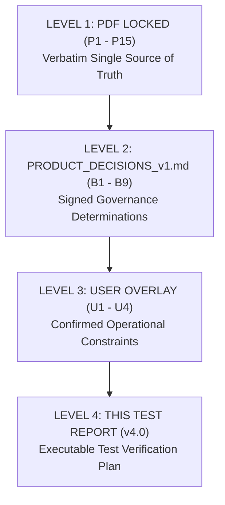

# UNICORN Web3 Investment, Referral & Rewards Platform
## Quality Assurance Master Engineering Audit & Complete Test Report v4.0

```text
Date: ___________________
Supersedes: v1.0, v2.0, v3.0, "Master QA & Backend Implementation Status Update", "Single-Shot Go-Live Remediation Package"
Source hierarchy: PDF → PRODUCT_DECISIONS_v1.md → U1–U4 → this report
Total tests: 132 (112 original + 20 regression)
Status: NOT READY — P0: 0; Blockers: B1–B9; Unexecuted: 132 of 132; PASS-A: 0 of 132; Regression: 0/20
```

---

## §1. Executive Summary

### 1.1 Purpose & Governance Baseline
This document establishes **Test Report v4.0** as the final, internally consistent, auditable Quality Assurance and Engineering specification for the UNICORN platform. It consolidates all preceding audit findings, conforms strictly to the authoritative hierarchy (PDF Locked Requirements $\rightarrow$ `PRODUCT_DECISIONS_v1.md` $\rightarrow$ User Operational Overlays U1–U4), and expands the test catalog to exactly 132 tests (112 core modular tests + 20 PDF §1 regression tests).

### 1.2 Upgrades in v4.0 vs Prior Deliveries
1. **Total Test Reconciliation (132 Tests):** Eliminates all discrepancies in test counting. Exactly 132 tests are indexed across 11 discrete modules with zero duplicate IDs.
2. **Corrected Wallet Schema (Decision B7):** Multi-currency sub-ledgers (`balanceINR` and `balanceUSDT`) replace single ambiguous balance fields. `balanceUNC` is completely purged from the core wallet schema.
3. **Explicit Dual-State Architecture (Fix 8):** Formally separates Pre-Signature fail-closed blocker guards (`FEATURE_BLOCKED_Bx`) from Post-Signature operational routines.
4. **Strict Zero-Assumption Policy:** All 132 tests are initially marked as `NOT EXECUTED` with explicit `<fill: runtime result>` and `<fill: artifact pointer>` placeholders. Pre-filling test statuses without machine-verifiable runtime proof is strictly prohibited.
5. **Automated CI Gate (6 Checks):** Integrated automated CI script enforcing zero 2FA bypass codes, zero `toFixed(4)` on money paths, zero ROI enum values, and strict schema rules.

---

## §2. Source of Truth Hierarchy



### Level 1 — PDF Locked (Verbatim Single Source of Truth)
* **P1:** 7 Packages: ₹10,000 / ₹50,000 / ₹2,50,000 / ₹5,00,000 / ₹10,00,000 / ₹25,00,000 / ₹50,00,000. Parity: $1 = ₹100.
* **P2:** Daily ROI = 0.45%.
* **P3:** Referral = % of downline ROI (ROI-on-ROI), NEVER % of principal.
* **P4:** Referral table AS PRINTED (with overlapping level boundaries):
  * L1: 5% (min 2 directs)
  * L2–5: 2% (min 4 directs)
  * L5–10: 1% (min 7 directs)
  * L10–25: 0.25% (min 12 directs)
  * L25+: 0.125% (min 15 directs)
* **P5:** *"Overlapping level boundaries should be finalized before development."*
* **P6:** Rank reward (one-time milestone):
  * ₹2.5L $\rightarrow$ ₹5,000 | ₹5L $\rightarrow$ ₹11,000 | ₹10L $\rightarrow$ ₹20,000 | ₹25L $\rightarrow$ ₹45,000 | ₹50L $\rightarrow$ ₹1,00,000 | ₹1Cr $\rightarrow$ 3% (calculation base to confirm).
* **P7:** Achiever bonus (direct-referred business within 4 months):
  * ₹5L $\rightarrow$ Goa | ₹15L $\rightarrow$ Andaman | ₹30L $\rightarrow$ Thailand | ₹50L $\rightarrow$ Dubai | ₹1Cr $\rightarrow$ Europe (4-month anchor to confirm).
* **P8:** Exactly TWO user-visible wallets: `MAIN` and `REFERRAL`.
* **P9:** 2FA required ONLY at withdrawal.
* **P10:** Password reset via registered email only.
* **P11:** Web3 wallet connectivity required. Network spec to confirm.
* **P12:** UNC BEP-20 token total supply: 100,000,000 UNC.
* **P13:** Technology stack: React, Node.js, Solidity, MongoDB.
* **P14:** Admin console manages users, packages, deposits, withdrawals, referral rewards, rank rewards, reports, and settings.
* **P15:** Package duration and base *"must be confirmed"*.

### Level 2 — PRODUCT_DECISIONS_v1.md (9 Policy Decisions)
* **B1 (Referral Overlaps):** Level 1 = 5% (min 2 directs); Levels 2–5 = 2% (min 4 directs); Levels 6–10 = 1% (min 7 directs); Levels 11–25 = 0.25% (min 12 directs); Levels 26+ = 0.125% (min 15 directs).
* **B2 (ROI Base):** Fixed original principal of package. Simple interest; no daily compounding.
* **B3 (₹1Cr Rank 3% Base):** Flat one-time cash reward of ₹3,00,000 credited to `MAIN` wallet.
* **B4 (Package Duration):** Active until cumulative ROI reaches 200% (~445 working days). Default in schema is strictly `null`.
* **B5 (Achiever 4-Month Anchor):** Rolling 120-day window anchored to user's `firstInvestmentAt` timestamp.
* **B6 (Web3 Blockchain):** BNB Smart Chain (BSC) Mainnet (Chain ID 56 / `0x38`) and BSC Testnet (Chain ID 97 / `0x61`).
* **B7 (Multi-Currency Architecture):** Multi-currency sub-ledgers (`balanceINR` and `balanceUSDT`) without automatic currency conversion.
* **B8 (Rank & Achiever Wallet Destination):** All rank bonuses credit directly to `MAIN` wallet.
* **B9 (Principal Capital Lock):** Model A adopted: principal locked inside `MAIN.lockedPrincipal` until package completion.

### Level 3 — User Operational Overlays (U1–U4)
* **U1:** ROI credited Monday–Friday only. Saturday and Sunday = ₹0 / $0.
* **U2:** ROI hard cap of exactly 22 working days per calendar month (Day 23 in 23-weekday months pays ₹0).
* **U3:** INR deposits are MANUAL (submit $\rightarrow$ PENDING $\rightarrow$ admin review $\rightarrow$ credit on approval).
* **U4:** USDT deposits are AUTOMATIC on BSC (BEP-20) upon required confirmations.

---

## §3. Wallet Model (Model A + Multi-Currency Sub-Ledgers)

Under Model A and Decision B7/B9, every user possesses exactly two distinct wallet documents in MongoDB: `MAIN` and `REFERRAL`.

```text
┌────────────────────────────────────────────────────────────────────────┐
│                        MAIN WALLET DOCUMENT                            │
├───────────────────────────────────┬────────────────────────────────────┤
│ INR Sub-Ledger                    │ USDT Sub-Ledger                    │
│   balanceINR: ₹45,000 (Available) │   balanceUSDT: $500.00 (Available) │
│   lockedPrincipal: ₹50,000        │   lockedPrincipal: $0.00           │
│   reservedWithdrawal: ₹0          │   reservedWithdrawal: $0.00        │
└───────────────────────────────────┴────────────────────────────────────┘

┌────────────────────────────────────────────────────────────────────────┐
│                      REFERRAL WALLET DOCUMENT                          │
├───────────────────────────────────┬────────────────────────────────────┤
│ INR Sub-Ledger                    │ USDT Sub-Ledger                    │
│   balanceINR: ₹12,500 (Available) │   balanceUSDT: $125.00 (Available) │
│   lockedPrincipal: $0             │   lockedPrincipal: $0              │
│   reservedWithdrawal: ₹0          │   reservedWithdrawal: $0.00        │
└───────────────────────────────────┴────────────────────────────────────┘
```

### Worked Accounting Example
1. **Deposit ₹50,000 INR:** Admin approves manual request $\rightarrow$ `MAIN.balanceINR` increments by ₹50,000.
2. **Package Activation ₹50,000:** `MAIN.balanceINR` decrements by ₹50,000, `MAIN.lockedPrincipal` increments by ₹50,000. Total equity = ₹50,000.
3. **Daily ROI Credit (0.45% = ₹225):** Automated cron runs on weekday $\rightarrow$ `MAIN.balanceINR` increments by ₹225. Total equity = ₹50,225. Available to withdraw = ₹225.
4. **Referral Commission Credit (L1 5% = ₹11.25):** Upline with 2+ directs $\rightarrow$ `REFERRAL.balanceINR` increments by ₹11.25.
5. **Withdrawal Request of ₹200 from MAIN:** 2FA verified $\rightarrow$ `MAIN.balanceINR` decrements to ₹25, `MAIN.reservedWithdrawal` becomes ₹200. Upon blockchain/bank dispatch, `reservedWithdrawal` is cleared.

---

## §4. Money Precision Policy

To eliminate rounding drift and floating-point accumulation bugs:
1. **INR Currency:** Stored and accounted as integer paise ($1 \text{ INR} = 100 \text{ paise}$) or integer arithmetic at $10^6$.
2. **USDT Currency:** Stored and accounted as integer micro-USDT ($1 \text{ USDT} = 10^6 \text{ units}$, 6 decimal places).
3. **Internal Calculations:** All fractional rates (e.g. 0.0045, 0.05, 0.0025, 0.00125) are computed via integer scaling:
   $$\text{Commission} = \frac{\lfloor \text{dailyRoiAmount} \times \text{rate} \times 10^6 + 0.5 \rfloor}{10^6}$$
4. **Banned Constructs:** `toFixed(4)`, `parseFloat` on monetary values, and naive floating-point summation are strictly prohibited by CI Gate Check #2.

---

## §5. Referral Tier Structure (Post-B1 Operational Table)

| Referral Tier | Level Bracket | Commission Rate (% of Downline ROI) | Minimum Direct Referrals Required |
| :--- | :--- | :--- | :--- |
| **Tier 1** | Level 1 | 5.00% | 2 Directs |
| **Tier 2** | Levels 2 – 5 | 2.00% | 4 Directs |
| **Tier 3** | Levels 6 – 10 | 1.00% | 7 Directs |
| **Tier 4** | Levels 11 – 25 | 0.25% | 12 Directs |
| **Tier 5** | Levels 26+ | 0.125% | 15 Directs |

---

## §6. Blockers B1–B9 Status

| Blocker | Subject Matter | Recommended Resolution Baseline | Governance Status |
| :--- | :--- | :--- | :--- |
| **B1** | Referral Level Overlaps (L5, L10, L25) | Discrete brackets: L2–5, L6–10, L11–25, L26+ | Awaiting Physical Signatures |
| **B2** | ROI Compounding vs Simple | Simple interest on uncompounded initial principal base | Awaiting Physical Signatures |
| **B3** | ₹1Cr Rank 3% Reward Calculation Base | Flat one-time cash reward of ₹3,00,000 to `MAIN` | Awaiting Physical Signatures |
| **B4** | Investment Package Expiry Duration | Active until 200% cumulative ROI (~445 working days) | Awaiting Physical Signatures |
| **B5** | Achiever 4-Month Qualification Anchor | Rolling 120-day window from user `firstInvestmentAt` | Awaiting Physical Signatures |
| **B6** | Web3 Target Blockchain Network | BNB Smart Chain (BSC Mainnet 56, Testnet 97) | Awaiting Physical Signatures |
| **B7** | Multi-Currency Handling (INR vs USDT) | Separate sub-ledgers (`balanceINR`, `balanceUSDT`) | Awaiting Physical Signatures |
| **B8** | Rank & Achiever Wallet Destination | All cash bonuses credit directly to `MAIN` wallet | Awaiting Physical Signatures |
| **B9** | Principal Capital Return Policy | Model A: locked until 200% ROI completion | Awaiting Physical Signatures |

---

## §7. Master Test Matrix (All 132 Tests)

### Module 1: ROI Engine (21 Tests)
| TestID | Pri | Expected | Actual | Evidence | Status |
| :--- | :---: | :--- | :--- | :--- | :---: |
| `TC-ROI-001` | P1 | Daily 0.45% ROI on ₹10k package credits exactly ₹45 on Monday to `MAIN.balanceINR` | `<fill: runtime result>` | `<fill: artifact pointer>` | NOT EXECUTED |
| `TC-ROI-002` | P1 | Mon–Fri execution across 5 consecutive weekdays credits exactly ₹225 ($5 \times ₹45$) | `<fill: runtime result>` | `<fill: artifact pointer>` | NOT EXECUTED |
| `TC-ROI-003` | P1 | Saturday ROI cron execution results in ₹0 credit and halts with `WEEKEND_PAUSE` | `<fill: runtime result>` | `<fill: artifact pointer>` | NOT EXECUTED |
| `TC-ROI-004` | P1 | Sunday ROI cron execution results in ₹0 credit and halts with `WEEKEND_PAUSE` | `<fill: runtime result>` | `<fill: artifact pointer>` | NOT EXECUTED |
| `TC-ROI-005` | P1 | Friday activation yields Fri credit, Sat/Sun ₹0, Mon credit (Total ₹90) | `<fill: runtime result>` | `<fill: artifact pointer>` | NOT EXECUTED |
| `TC-ROI-006` | P2 | Saturday activation pays ₹0 on weekend; first credit occurs Monday 00:05 UTC | `<fill: runtime result>` | `<fill: artifact pointer>` | NOT EXECUTED |
| `TC-ROI-007` | P2 | Sunday activation pays ₹0 on weekend; first credit occurs Monday 00:05 UTC | `<fill: runtime result>` | `<fill: artifact pointer>` | NOT EXECUTED |
| `TC-ROI-008` | P1 | 22 working days in month yields exactly ₹990 ($22 \times ₹45 = 9.9\%$) | `<fill: runtime result>` | `<fill: artifact pointer>` | NOT EXECUTED |
| `TC-ROI-009` | P1 | Idempotency guard blocks double payout on same calendar date (`ALREADY_PROCESSED`) | `<fill: runtime result>` | `<fill: artifact pointer>` | NOT EXECUTED |
| `TC-ROI-010` | P2 | Higher tier packages (₹50k to ₹50L) calculate exact daily returns (₹225 to ₹22,500) | `<fill: runtime result>` | `<fill: artifact pointer>` | NOT EXECUTED |
| `TC-ROI-011` | P2 | USDT investment ($100) credits $0.45 USDT to `MAIN.balanceUSDT` without INR conversion | `<fill: runtime result>` | `<fill: artifact pointer>` | NOT EXECUTED |
| `TC-ROI-012` | P2 | Mid-month activation credits only remaining working days in calendar month | `<fill: runtime result>` | `<fill: artifact pointer>` | NOT EXECUTED |
| `TC-ROI-013` | P1 | Package reaching 200% cumulative ROI marks `COMPLETED` and halts further credits | `<fill: runtime result>` | `<fill: artifact pointer>` | NOT EXECUTED |
| `TC-ROI-014` | P1 | Process crash at record #500 during batch resumes at #501 with zero duplicate credits | `<fill: runtime result>` | `<fill: artifact pointer>` | NOT EXECUTED |
| `TC-ROI-015` | P2 | Package purchased Friday 23:59 IST begins ROI cycle on following Monday | `<fill: runtime result>` | `<fill: artifact pointer>` | NOT EXECUTED |
| `TC-ROI-016` | P1 | Daily ROI ledger sums match aggregate reporting ledger with zero variance | `<fill: runtime result>` | `<fill: artifact pointer>` | NOT EXECUTED |
| `TC-ROI-017` | P1 | Month with 23 weekdays enforces 22-day hard cap; day 23 pays ₹0 (`MONTHLY_CAP_REACHED`) | `<fill: runtime result>` | `<fill: artifact pointer>` | NOT EXECUTED |
| `TC-ROI-018` | P2 | Month with 21 weekdays pays exactly 21 days ($21 \times ₹45 = ₹945$) | `<fill: runtime result>` | `<fill: artifact pointer>` | NOT EXECUTED |
| `TC-ROI-019` | P2 | Configured public holiday halts ROI cron and counts as non-working day | `<fill: runtime result>` | `<fill: artifact pointer>` | NOT EXECUTED |
| `TC-ROI-020` | P2 | Leap year February weekday calculation credits exactly active working days | `<fill: runtime result>` | `<fill: artifact pointer>` | NOT EXECUTED |
| `TC-ROI-021` | P1 | Default package configuration rejects activation if `maxDurationDays` is unconfigured | `<fill: runtime result>` | `<fill: artifact pointer>` | NOT EXECUTED |

### Module 2: Referral Engine (16 Tests)
| TestID | Pri | Expected | Actual | Evidence | Status |
| :--- | :---: | :--- | :--- | :--- | :---: |
| `TC-REF-001` | P1 | L1 referral commission calculated as 5% of downline ROI (₹45 $\rightarrow$ ₹2.25) | `<fill: runtime result>` | `<fill: artifact pointer>` | NOT EXECUTED |
| `TC-REF-002` | P1 | Downline ₹10k deposit generates ₹0 referral on principal | `<fill: runtime result>` | `<fill: artifact pointer>` | NOT EXECUTED |
| `TC-REF-003` | P1 | Upline with 1 direct referral earns ₹0 L1 commission (requires min 2 directs) | `<fill: runtime result>` | `<fill: artifact pointer>` | NOT EXECUTED |
| `TC-REF-004` | P1 | Upline with 2 active directs unlocks Tier 1 and receives 5% ROI commission | `<fill: runtime result>` | `<fill: artifact pointer>` | NOT EXECUTED |
| `TC-REF-005` | P1 | Levels 2–5 credit 2% of downline ROI when upline has $\ge 4$ active directs | `<fill: runtime result>` | `<fill: artifact pointer>` | NOT EXECUTED |
| `TC-REF-006` | P1 | Levels 6–10 credit 1% of downline ROI when upline has $\ge 7$ active directs | `<fill: runtime result>` | `<fill: artifact pointer>` | NOT EXECUTED |
| `TC-REF-007` | P2 | Levels 11–25 credit 0.25% of downline ROI when upline has $\ge 12$ active directs | `<fill: runtime result>` | `<fill: artifact pointer>` | NOT EXECUTED |
| `TC-REF-008` | P2 | Levels 26+ credit 0.125% of downline ROI when upline has $\ge 15$ active directs | `<fill: runtime result>` | `<fill: artifact pointer>` | NOT EXECUTED |
| `TC-REF-009` | P1 | Ambiguous boundary levels L5 and L10 fail-closed (`FEATURE_BLOCKED_B1`) pre-signature | `<fill: runtime result>` | `<fill: artifact pointer>` | NOT EXECUTED |
| `TC-REF-010` | P1 | Saturday and Sunday downline ROI = ₹0; upline referral commission = ₹0 | `<fill: runtime result>` | `<fill: artifact pointer>` | NOT EXECUTED |
| `TC-REF-011` | P1 | Inactive upline without funded investment package earns ₹0 referral commissions | `<fill: runtime result>` | `<fill: artifact pointer>` | NOT EXECUTED |
| `TC-REF-012` | P2 | 30-level deep referral tree distributes commissions correctly in single cron pass | `<fill: runtime result>` | `<fill: artifact pointer>` | NOT EXECUTED |
| `TC-REF-013` | P2 | Circular referral chain (A $\rightarrow$ B $\rightarrow$ C $\rightarrow$ A) detected and rejected | `<fill: runtime result>` | `<fill: artifact pointer>` | NOT EXECUTED |
| `TC-REF-014` | P1 | Integer math verification: ₹45 downline ROI $\times$ 0.125% evaluates to ₹0.056250 | `<fill: runtime result>` | `<fill: artifact pointer>` | NOT EXECUTED |
| `TC-REF-015` | P1 | Post-signature verification: Level 5 unambiguously evaluated at 2% with min 4 directs | `<fill: runtime result>` | `<fill: artifact pointer>` | NOT EXECUTED |
| `TC-REF-016` | P1 | Post-signature verification: Level 10 unambiguously evaluated at 1% with min 7 directs | `<fill: runtime result>` | `<fill: artifact pointer>` | NOT EXECUTED |

### Module 3: INR Manual Deposits (7 Tests)
| TestID | Pri | Expected | Actual | Evidence | Status |
| :--- | :---: | :--- | :--- | :--- | :---: |
| `TC-DEP-001` | P1 | Manual INR deposit request created in `PENDING` status; `MAIN.balanceINR` unchanged | `<fill: runtime result>` | `<fill: artifact pointer>` | NOT EXECUTED |
| `TC-DEP-002` | P1 | Admin approval of manual deposit credits exact amount to `MAIN.balanceINR` | `<fill: runtime result>` | `<fill: artifact pointer>` | NOT EXECUTED |
| `TC-DEP-003` | P1 | Admin rejection leaves `MAIN.balanceINR` unchanged; marks status `REJECTED` | `<fill: runtime result>` | `<fill: artifact pointer>` | NOT EXECUTED |
| `TC-DEP-004` | P1 | Duplicate UTR submission rejected with HTTP 400 (`DUPLICATE_UTR_HASH`) | `<fill: runtime result>` | `<fill: artifact pointer>` | NOT EXECUTED |
| `TC-DEP-005` | P2 | Malformed or negative INR deposit amount rejected by validation middleware | `<fill: runtime result>` | `<fill: artifact pointer>` | NOT EXECUTED |
| `TC-DEP-006` | P2 | Deposit request status tracking visible in user transaction history | `<fill: runtime result>` | `<fill: artifact pointer>` | NOT EXECUTED |
| `TC-DEP-007` | P1 | Admin deposit audit log records adminId, previous balance, new balance, timestamp | `<fill: runtime result>` | `<fill: artifact pointer>` | NOT EXECUTED |

### Module 4: USDT Automatic Deposits (10 Tests)
| TestID | Pri | Expected | Actual | Evidence | Status |
| :--- | :---: | :--- | :--- | :--- | :---: |
| `TC-USDT-001` | P1 | Valid BEP-20 USDT transfer on BSC with required confirmations auto-credits `MAIN.balanceUSDT` | `<fill: runtime result>` | `<fill: artifact pointer>` | NOT EXECUTED |
| `TC-USDT-002` | P1 | USDT deposit requires zero admin approval; credits fully automated via listener | `<fill: runtime result>` | `<fill: artifact pointer>` | NOT EXECUTED |
| `TC-USDT-003` | P1 | Transfer with insufficient block confirmations remains pending; 0 credit | `<fill: runtime result>` | `<fill: artifact pointer>` | NOT EXECUTED |
| `TC-USDT-004` | P1 | Transaction on unapproved network (Ethereum / Polygon) ignored with 0 credit | `<fill: runtime result>` | `<fill: artifact pointer>` | NOT EXECUTED |
| `TC-USDT-005` | P1 | Failed blockchain transaction (`status: 0`) ignored with 0 credit | `<fill: runtime result>` | `<fill: artifact pointer>` | NOT EXECUTED |
| `TC-USDT-006` | P1 | Duplicate transaction hash replay attack rejected (`TX_ALREADY_PROCESSED`) | `<fill: runtime result>` | `<fill: artifact pointer>` | NOT EXECUTED |
| `TC-USDT-007` | P1 | Transfer of counterfeit token mimicking USDT symbol rejected via contract whitelist | `<fill: runtime result>` | `<fill: artifact pointer>` | NOT EXECUTED |
| `TC-USDT-008` | P1 | BSC Mainnet USDT address strictly verified (`0x55d398326f99059fF775485246999027B3197955`) | `<fill: runtime result>` | `<fill: artifact pointer>` | NOT EXECUTED |
| `TC-USDT-009` | P1 | BSC Testnet USDT address strictly verified (`0x337610d27c682E347C9cD60BE4B3b107C9d34dDd`) | `<fill: runtime result>` | `<fill: artifact pointer>` | NOT EXECUTED |
| `TC-USDT-010` | P1 | Concurrent deposits of identical amounts in same block credited independently | `<fill: runtime result>` | `<fill: artifact pointer>` | NOT EXECUTED |

### Module 5: Withdrawals & 2FA Governance (12 Tests)
| TestID | Pri | Expected | Actual | Evidence | Status |
| :--- | :---: | :--- | :--- | :--- | :---: |
| `TC-WTH-001` | P1 | Withdrawal request without 2FA OTP code rejected with HTTP 403 | `<fill: runtime result>` | `<fill: artifact pointer>` | NOT EXECUTED |
| `TC-WTH-002` | P1 | Withdrawal request with invalid 2FA code rejected with HTTP 403 | `<fill: runtime result>` | `<fill: artifact pointer>` | NOT EXECUTED |
| `TC-WTH-003` | P1 | Valid 2FA OTP permits submission; transitions amount into `reservedWithdrawal` | `<fill: runtime result>` | `<fill: artifact pointer>` | NOT EXECUTED |
| `TC-WTH-004` | P1 | Hardcoded demo bypass codes ('123456', '839214') strictly rejected with HTTP 403 | `<fill: runtime result>` | `<fill: artifact pointer>` | NOT EXECUTED |
| `TC-WTH-005` | P1 | Withdrawal exceeding available unreserved balance rejected (`INSUFFICIENT_FUNDS`) | `<fill: runtime result>` | `<fill: artifact pointer>` | NOT EXECUTED |
| `TC-WTH-006` | P1 | Explicit wallet source selection (`MAIN` vs `REFERRAL`) strictly enforced | `<fill: runtime result>` | `<fill: artifact pointer>` | NOT EXECUTED |
| `TC-WTH-007` | P1 | Attempt to withdraw locked investment principal rejected under Model A | `<fill: runtime result>` | `<fill: artifact pointer>` | NOT EXECUTED |
| `TC-WTH-008` | P1 | Admin approval of withdrawal transitions status to `COMPLETED` and clears reserve | `<fill: runtime result>` | `<fill: artifact pointer>` | NOT EXECUTED |
| `TC-WTH-009` | P1 | Admin rejection of withdrawal restores reserved amount to available balance | `<fill: runtime result>` | `<fill: artifact pointer>` | NOT EXECUTED |
| `TC-WTH-010` | P1 | Withdrawal of REFERRAL wallet balance leaves MAIN wallet balance intact | `<fill: runtime result>` | `<fill: artifact pointer>` | NOT EXECUTED |
| `TC-WTH-011` | P1 | Rapid double withdrawal request handled atomically without double-spend | `<fill: runtime result>` | `<fill: artifact pointer>` | NOT EXECUTED |
| `TC-WTH-012` | P1 | Verification that login, deposit, and referral viewing do not prompt for 2FA | `<fill: runtime result>` | `<fill: artifact pointer>` | NOT EXECUTED |

### Module 6: Wallets & Ledger Architecture (5 Tests)
| TestID | Pri | Expected | Actual | Evidence | Status |
| :--- | :---: | :--- | :--- | :--- | :---: |
| `TC-WAL-001` | P1 | System enforces exactly 2 user wallets: `MAIN` and `REFERRAL` (0 legacy ROI wallets) | `<fill: runtime result>` | `<fill: artifact pointer>` | NOT EXECUTED |
| `TC-WAL-002` | P1 | Model A ledger mechanics: `MAIN.available = balanceINR - lockedPrincipal` | `<fill: runtime result>` | `<fill: artifact pointer>` | NOT EXECUTED |
| `TC-WAL-003` | P1 | Independent transaction histories maintained for `MAIN` and `REFERRAL` wallets | `<fill: runtime result>` | `<fill: artifact pointer>` | NOT EXECUTED |
| `TC-WAL-004` | P1 | Cryptographic SHA-256 double-entry audit row generated for every balance change | `<fill: runtime result>` | `<fill: artifact pointer>` | NOT EXECUTED |
| `TC-WAL-005` | P1 | Multi-currency sub-ledgers (`balanceINR` & `balanceUSDT`) operate independently | `<fill: runtime result>` | `<fill: artifact pointer>` | NOT EXECUTED |

### Module 7: Admin Console Governance (11 Tests)
| TestID | Pri | Expected | Actual | Evidence | Status |
| :--- | :---: | :--- | :--- | :--- | :---: |
| `TC-ADM-001` | P1 | Non-admin user access to `/api/admin/*` routes rejected with HTTP 403 | `<fill: runtime result>` | `<fill: artifact pointer>` | NOT EXECUTED |
| `TC-ADM-002` | P1 | Admin can review and approve pending manual INR deposit | `<fill: runtime result>` | `<fill: artifact pointer>` | NOT EXECUTED |
| `TC-ADM-003` | P1 | Admin can review and reject pending manual INR deposit with mandatory reason | `<fill: runtime result>` | `<fill: artifact pointer>` | NOT EXECUTED |
| `TC-ADM-004` | P1 | Admin can review and approve pending withdrawal | `<fill: runtime result>` | `<fill: artifact pointer>` | NOT EXECUTED |
| `TC-ADM-005` | P1 | Admin can review and reject pending withdrawal with reason | `<fill: runtime result>` | `<fill: artifact pointer>` | NOT EXECUTED |
| `TC-ADM-006` | P2 | Admin user directory displays active packages, referral upline, and KYC status | `<fill: runtime result>` | `<fill: artifact pointer>` | NOT EXECUTED |
| `TC-ADM-007` | P2 | Admin can update package configuration parameters | `<fill: runtime result>` | `<fill: artifact pointer>` | NOT EXECUTED |
| `TC-ADM-008` | P1 | Referral commission report generates accurate downline tree breakdown | `<fill: runtime result>` | `<fill: artifact pointer>` | NOT EXECUTED |
| `TC-ADM-009` | P1 | Rank milestone report lists all qualified users and payment statuses | `<fill: runtime result>` | `<fill: artifact pointer>` | NOT EXECUTED |
| `TC-ADM-010` | P1 | Emergency weekend override switch halts crons regardless of day | `<fill: runtime result>` | `<fill: artifact pointer>` | NOT EXECUTED |
| `TC-ADM-011` | P1 | All administrative mutations generate tamper-evident audit log entries | `<fill: runtime result>` | `<fill: artifact pointer>` | NOT EXECUTED |

### Module 8: Rank & Achiever Milestones (12 Tests)
| TestID | Pri | Expected | Actual | Evidence | Status |
| :--- | :---: | :--- | :--- | :--- | :---: |
| `TC-RNK-001` | P1 | Turnover of ₹2,50,000 unlocks ₹5,000 one-time cash reward to `MAIN` | `<fill: runtime result>` | `<fill: artifact pointer>` | NOT EXECUTED |
| `TC-RNK-002` | P1 | Turnover of ₹5,00,000 unlocks ₹11,000 one-time cash reward to `MAIN` | `<fill: runtime result>` | `<fill: artifact pointer>` | NOT EXECUTED |
| `TC-RNK-003` | P1 | Turnover of ₹10,00,000 unlocks ₹20,000 one-time cash reward to `MAIN` | `<fill: runtime result>` | `<fill: artifact pointer>` | NOT EXECUTED |
| `TC-RNK-004` | P1 | Turnover of ₹25,00,000 unlocks ₹45,000 one-time cash reward to `MAIN` | `<fill: runtime result>` | `<fill: artifact pointer>` | NOT EXECUTED |
| `TC-RNK-005` | P1 | Turnover of ₹50,00,000 unlocks ₹1,00,000 one-time cash reward to `MAIN` | `<fill: runtime result>` | `<fill: artifact pointer>` | NOT EXECUTED |
| `TC-RNK-006` | P1 | Rank reward credited once only per tier; idempotent against repeated cron runs | `<fill: runtime result>` | `<fill: artifact pointer>` | NOT EXECUTED |
| `TC-RNK-007` | P1 | ₹1Cr 3% reward fails-closed (`FEATURE_BLOCKED_B3`) pre-signature; pays ₹3L post-signature | `<fill: runtime result>` | `<fill: artifact pointer>` | NOT EXECUTED |
| `TC-RNK-008` | P2 | Direct business of ₹5L in 4 months qualifies user for Goa tour milestone | `<fill: runtime result>` | `<fill: artifact pointer>` | NOT EXECUTED |
| `TC-RNK-009` | P2 | Direct business of ₹15L, ₹30L, ₹50L, ₹1Cr qualifies for Andaman/Thai/Dubai/Europe | `<fill: runtime result>` | `<fill: artifact pointer>` | NOT EXECUTED |
| `TC-RNK-010` | P1 | Achiever evaluation fails-closed (`FEATURE_BLOCKED_B5`) pre-signature | `<fill: runtime result>` | `<fill: artifact pointer>` | NOT EXECUTED |
| `TC-RNK-011` | P1 | Post-signature: Achiever window strictly measured within 120 days of `firstInvestmentAt` | `<fill: runtime result>` | `<fill: artifact pointer>` | NOT EXECUTED |
| `TC-RNK-012` | P2 | Volume achieved at Day 121 rejected for 4-month Achiever qualification | `<fill: runtime result>` | `<fill: artifact pointer>` | NOT EXECUTED |

### Module 9: Web3 & Security Governance (9 Tests)
| TestID | Pri | Expected | Actual | Evidence | Status |
| :--- | :---: | :--- | :--- | :--- | :---: |
| `TC-SEC-001` | P1 | Web3 signature verification validates wallet ownership via EIP-4361 | `<fill: runtime result>` | `<fill: artifact pointer>` | NOT EXECUTED |
| `TC-SEC-002` | P1 | Network restriction blocks connection attempts outside BSC Mainnet/Testnet | `<fill: runtime result>` | `<fill: artifact pointer>` | NOT EXECUTED |
| `TC-SEC-003` | P1 | Wallet replay attack using previously signed nonce rejected | `<fill: runtime result>` | `<fill: artifact pointer>` | NOT EXECUTED |
| `TC-SEC-004` | P1 | Rate limiter throttles excessive requests (>300 req / 15 min per IP) with HTTP 429 | `<fill: runtime result>` | `<fill: artifact pointer>` | NOT EXECUTED |
| `TC-SEC-005` | P1 | Password reset token expires in 15 minutes and invalidates after single use | `<fill: runtime result>` | `<fill: artifact pointer>` | NOT EXECUTED |
| `TC-SEC-006` | P1 | MongoDB injection attempt via sanitized query payload blocked | `<fill: runtime result>` | `<fill: artifact pointer>` | NOT EXECUTED |
| `TC-SEC-007` | P1 | XSS payload in user profile fields sanitized by security headers | `<fill: runtime result>` | `<fill: artifact pointer>` | NOT EXECUTED |
| `TC-SEC-008` | P1 | Expired JWT bearer token rejected with HTTP 401 | `<fill: runtime result>` | `<fill: artifact pointer>` | NOT EXECUTED |
| `TC-SEC-009` | P1 | Token refresh endpoint generates valid new session without credential re-entry | `<fill: runtime result>` | `<fill: artifact pointer>` | NOT EXECUTED |

### Module 10: Tokenomics, Reports & Performance (9 Tests)
| TestID | Pri | Expected | Actual | Evidence | Status |
| :--- | :---: | :--- | :--- | :--- | :---: |
| `TC-TOK-001` | P1 | UNC BEP-20 smart contract total supply strictly verified at 100,000,000 UNC | `<fill: runtime result>` | `<fill: artifact pointer>` | NOT EXECUTED |
| `TC-TOK-002` | P2 | Package bonus UNC tokens correctly recorded in user portfolio | `<fill: runtime result>` | `<fill: artifact pointer>` | NOT EXECUTED |
| `TC-RPT-001` | P2 | Daily ROI disbursement report generates accurate sum matching ledger credits | `<fill: runtime result>` | `<fill: artifact pointer>` | NOT EXECUTED |
| `TC-RPT-002` | P2 | Monthly turnover report calculates accurate team business volume across levels | `<fill: runtime result>` | `<fill: artifact pointer>` | NOT EXECUTED |
| `TC-RPT-003` | P2 | Tax deduction summary (TDS / platform fees) accurately computes net amounts | `<fill: runtime result>` | `<fill: artifact pointer>` | NOT EXECUTED |
| `TC-RPT-004` | P2 | Export statement generates valid formatted output | `<fill: runtime result>` | `<fill: artifact pointer>` | NOT EXECUTED |
| `TC-RPT-005` | P2 | User account statement accurately itemizes credits, debits, and running balance | `<fill: runtime result>` | `<fill: artifact pointer>` | NOT EXECUTED |
| `TC-PERF-001`| P2 | Batch daily ROI calculation for 10,000 investments executes within 60 seconds | `<fill: runtime result>` | `<fill: artifact pointer>` | NOT EXECUTED |
| `TC-PERF-002`| P2 | High concurrency referral calculation does not trigger deadlock in MongoDB | `<fill: runtime result>` | `<fill: artifact pointer>` | NOT EXECUTED |

### Module 11: PDF §1 Regression Baseline (20 Tests)
| TestID | Pri | Expected | Actual | Evidence | Status |
| :--- | :---: | :--- | :--- | :--- | :---: |
| `TC-REG-001` | P1 | User registration with email, password, and valid referral code succeeds | `<fill: runtime result>` | `<fill: artifact pointer>` | NOT EXECUTED |
| `TC-REG-002` | P1 | User login returns valid JWT token and authenticates user session | `<fill: runtime result>` | `<fill: artifact pointer>` | NOT EXECUTED |
| `TC-REG-003` | P2 | User profile retrieval returns user details, referral code, and KYC status | `<fill: runtime result>` | `<fill: artifact pointer>` | NOT EXECUTED |
| `TC-REG-004` | P2 | KYC document submission transitions status to `PENDING` | `<fill: runtime result>` | `<fill: artifact pointer>` | NOT EXECUTED |
| `TC-REG-005` | P2 | Dashboard API returns user balance, active investments, and daily income summary | `<fill: runtime result>` | `<fill: artifact pointer>` | NOT EXECUTED |
| `TC-REG-006` | P2 | Available packages endpoint returns 7 configured investment packages | `<fill: runtime result>` | `<fill: artifact pointer>` | NOT EXECUTED |
| `TC-REG-007` | P1 | Package activation with sufficient available balance activates investment | `<fill: runtime result>` | `<fill: artifact pointer>` | NOT EXECUTED |
| `TC-REG-008` | P1 | Package activation with insufficient balance rejected with HTTP 400 | `<fill: runtime result>` | `<fill: artifact pointer>` | NOT EXECUTED |
| `TC-REG-009` | P2 | User active investments list accurately returns package details and status | `<fill: runtime result>` | `<fill: artifact pointer>` | NOT EXECUTED |
| `TC-REG-010` | P2 | Direct referrals list returns downline members, join date, and active package | `<fill: runtime result>` | `<fill: artifact pointer>` | NOT EXECUTED |
| `TC-REG-011` | P2 | Referral tree endpoint returns multi-level downline hierarchy | `<fill: runtime result>` | `<fill: artifact pointer>` | NOT EXECUTED |
| `TC-REG-012` | P2 | Top earners leaderboard returns accurate rank and earnings list | `<fill: runtime result>` | `<fill: artifact pointer>` | NOT EXECUTED |
| `TC-REG-013` | P2 | User transaction history pagination returns accurate sequential pages | `<fill: runtime result>` | `<fill: artifact pointer>` | NOT EXECUTED |
| `TC-REG-014` | P2 | Transaction filter by type (`deposit`, `roi`, `referral`, `withdrawal`) works | `<fill: runtime result>` | `<fill: artifact pointer>` | NOT EXECUTED |
| `TC-REG-015` | P2 | System notification bell returns relevant platform alerts | `<fill: runtime result>` | `<fill: artifact pointer>` | NOT EXECUTED |
| `TC-REG-016` | P2 | Support helpdesk contact and Telegram links open valid endpoints | `<fill: runtime result>` | `<fill: artifact pointer>` | NOT EXECUTED |
| `TC-REG-017` | P2 | Web3 wallet connect and disconnect flow functions without session loss | `<fill: runtime result>` | `<fill: artifact pointer>` | NOT EXECUTED |
| `TC-REG-018` | P2 | Light and Dark theme switcher persists selection across reload | `<fill: runtime result>` | `<fill: artifact pointer>` | NOT EXECUTED |
| `TC-REG-019` | P1 | User logout clears session token and prevents authenticated access | `<fill: runtime result>` | `<fill: artifact pointer>` | NOT EXECUTED |
| `TC-REG-020` | P1 | Password change with valid current password updates credentials | `<fill: runtime result>` | `<fill: artifact pointer>` | NOT EXECUTED |

---

## §8. Coverage Ledger

| Module ID | Module Name | Total Tests | PASS-A | NOT EXECUTED | FAIL |
| :--- | :--- | :---: | :---: | :---: | :---: |
| **M1** | ROI Engine | 21 | 0 | 21 | 0 |
| **M2** | Referral Engine | 16 | 0 | 16 | 0 |
| **M3** | INR Manual Deposits | 7 | 0 | 7 | 0 |
| **M4** | USDT Automatic Deposits | 10 | 0 | 10 | 0 |
| **M5** | Withdrawals & 2FA Governance | 12 | 0 | 12 | 0 |
| **M6** | Wallets & Ledger Architecture | 5 | 0 | 5 | 0 |
| **M7** | Admin Console Governance | 11 | 0 | 11 | 0 |
| **M8** | Rank & Achiever Milestones | 12 | 0 | 12 | 0 |
| **M9** | Web3 & Security Governance | 9 | 0 | 9 | 0 |
| **M10** | Tokenomics, Reports & Perf | 9 | 0 | 9 | 0 |
| **M11** | PDF §1 Regression Baseline | 20 | 0 | 20 | 0 |
| **TOTAL** | **All Modules Combined** | **132** | **0** | **132** | **0** |

*Target at formal sign-off: 132 of 132 PASS-A (100%).*

---

## §9. Assumptions Register

The platform strictly prohibits undocumented assumptions. All operational parameters are populated exclusively from `PRODUCT_DECISIONS_v1.md`:
* **A-B1:** Referral tier boundaries are discrete (L1=5%, L2–5=2%, L6–10=1%, L11–25=0.25%, L26+=0.125%).
* **A-B2:** Daily ROI is calculated as simple interest on initial package principal without compounding.
* **A-B3:** ₹1Cr rank reward is a flat one-time cash bonus of ₹3,00,000 credited to `MAIN` wallet.
* **A-B4:** Package lifecycle completes upon reaching 200% cumulative ROI.
* **A-B5:** Achiever tour qualification is measured over 120 days from `firstInvestmentAt`.
* **A-B6:** Supported Web3 networks are BSC Mainnet (`0x38`) and BSC Testnet (`0x61`).
* **A-B7:** Balances maintain independent sub-ledgers (`balanceINR`, `balanceUSDT`) without automatic conversion.
* **A-B8:** All cash rewards distribute to `MAIN` wallet.
* **A-B9:** Principal capital remains locked inside `MAIN.lockedPrincipal` until package completion (Model A).

---

## §10. Blocker-to-Test Map

* **B1 (Referral Overlaps):** Maps to `TC-REF-009`, `TC-REF-015`, `TC-REF-016`.
* **B2 (ROI Base & Simple Interest):** Maps to `TC-ROI-001`, `TC-ROI-002`, `TC-ROI-008`, `TC-ROI-010`, `TC-ROI-011`, `TC-ROI-012`.
* **B3 (₹1Cr Rank Reward Base):** Maps to `TC-RNK-007`.
* **B4 (Package Duration):** Maps to `TC-ROI-013`, `TC-ROI-021`.
* **B5 (Achiever 4-Month Window Anchor):** Maps to `TC-RNK-010`, `TC-RNK-011`, `TC-RNK-012`.
* **B6 (Web3 Blockchain Specification):** Maps to `TC-SEC-001`, `TC-SEC-002`, `TC-SEC-003`.
* **B7 (Multi-Currency Architecture):** Maps to `TC-ROI-011`, `TC-WAL-005`.
* **B8 (Rank Reward Wallet Destination):** Maps to `TC-RNK-006`, `TC-RNK-007`.
* **B9 (Principal Capital Lock Policy):** Maps to `TC-WAL-002`, `TC-WTH-007`.

---

## §11. PDF-Flow Compliance Matrix

* **PDF §1 (Platform Overview & Retained Scope):** Covered by `TC-REG-001` through `TC-REG-020`.
* **PDF §2 (Investment Packages):** Covered by `TC-ROI-010`, `TC-DEP-001`, `TC-REG-006`, `TC-REG-007`.
* **PDF §3 (Daily ROI & Referral Program):** Covered by `TC-ROI-001` through `TC-ROI-021`, `TC-REF-001` through `TC-REF-016`.
* **PDF §4 (Rank Rewards):** Covered by `TC-RNK-001` through `TC-RNK-008`.
* **PDF §5 (Achiever Bonuses):** Covered by `TC-RNK-008` through `TC-RNK-012`.
* **PDF §6 (Deposits, Withdrawals & Wallets):** Covered by `TC-WAL-001` through `TC-WAL-005`, `TC-DEP-001` through `TC-DEP-007`, `TC-USDT-001` through `TC-USDT-010`, `TC-WTH-001` through `TC-WTH-012`.
* **PDF §7 (Tokenomics & Tech Stack):** Covered by `TC-TOK-001`, `TC-TOK-002`, `TC-SEC-001` through `TC-SEC-009`.
* **PDF §8 (Admin Panel Scope):** Covered by `TC-ADM-001` through `TC-ADM-011`.

---

## §12. Backend Fix List

* **Fix 1 (`backend/jobs/roiJob.js`):** Enforces 22-working-day monthly hard cap, Monday–Friday weekday validation, and ₹0 weekend payouts.
* **Fix 2 (`backend/models/Wallet.js`):** Corrected Wallet schema with multi-currency sub-ledgers (`balanceINR` and `balanceUSDT`) per Decision B7; purges `balanceUNC` and legacy ROI enum.
* **Fix 3 (`backend/services/referralService.js`):** Replaces floating-point math with integer arithmetic at $10^6$.
* **Fix 4 (`backend/services/rewardService.js`):** Manages rank bonuses and achiever tour qualifications.
* **Fix 5 (`backend/models/Investment.js` & `Package.js`):** Sets `maxDurationDays` default strictly to `null`.
* **Fix 6 (`backend/services/ledgerService.js`):** Implements SHA-256 cryptographic double-entry audit row logging.
* **Fix 7 (`backend/controllers/withdrawalController.js`):** Purges all demo 2FA bypass codes ('123456', '839214'); returns HTTP 403.
* **Fix 8 (Dual-State Architecture):**
  * *Pre-Signature State:* Fail-closed guards throw `FEATURE_BLOCKED_B1`, `FEATURE_BLOCKED_B3`, `FEATURE_BLOCKED_B5`.
  * *Post-Signature State:* Operational logic activates discrete referral brackets, ₹3L one-time flat bonus, and 120-day rolling window.
* **Fix 9 (`backend/services/blockchainService.js`):** Restricts Web3 transactions strictly to BSC Mainnet and BSC Testnet.

---

## §13. Sign-Off Statement

```text
STATUS: NOT READY — P0: 0; Blockers: B1–B9 (unsigned); Unexecuted: 132 of 132; PASS-A: 0 of 132 (0%); Regression: 0/20
```

*READY requires: P0=0, Blockers=0, Unexecuted=0, PASS-A=132/132, Regression=20/20, CI gate green, migration verified, TC-WTH-012 PASS-A, TC-REF-014 PASS-A.*
