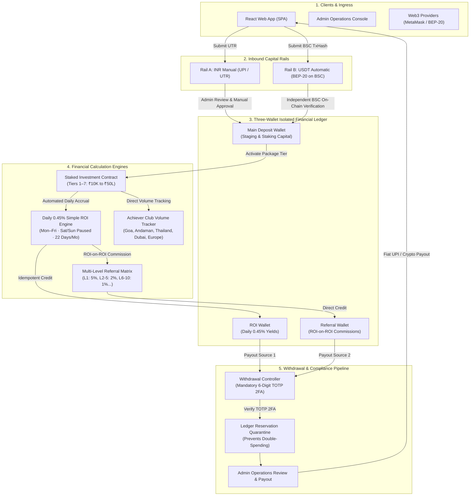
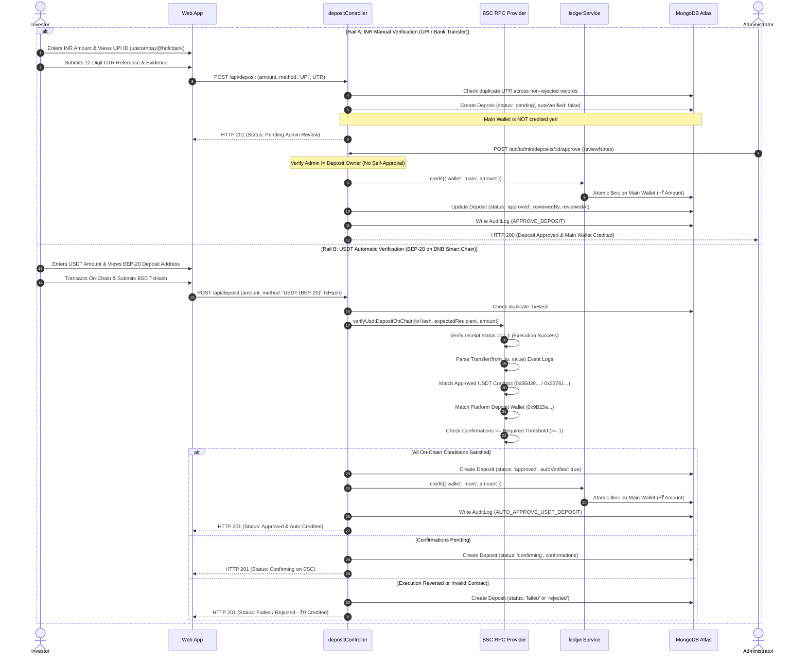
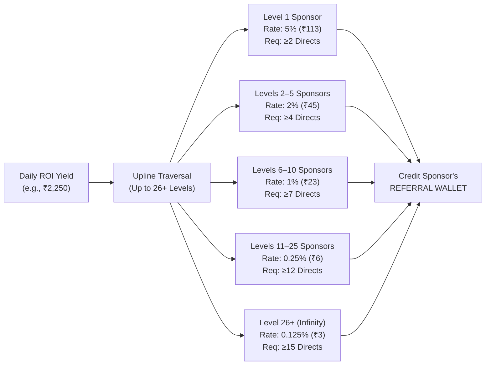
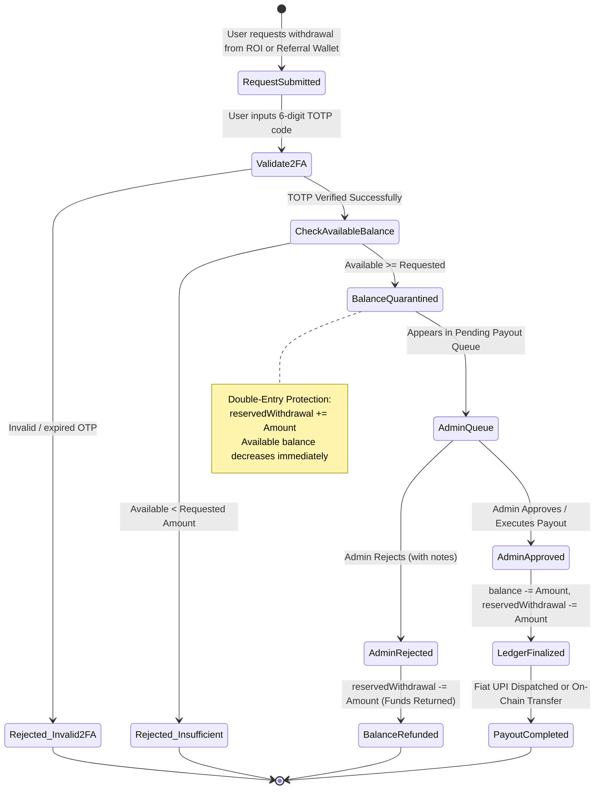

# UNICORN Web3 Platform — Complete End-to-End Backend Workflow

## 1. System Architectural Overview

The UNICORN backend is an enterprise-grade Node.js / Express & MongoDB financial ledger application engineered for high-concurrency staking, auditable dual-rail payment processing (Fiat UPI and Web3 BEP-20 USDT), an automated **0.45% Daily Simple ROI Engine (22 earning days per month)**, a **Multi-Level Referral Matrix**, and **Time-based One-Time Password (TOTP) 2FA** withdrawal security.



---

## 2. Directory Structure & Module Responsibilities

```
backend/
├── config/
│   └── database.js                # MongoDB Atlas connection pool & DNS resilience
├── controllers/
│   ├── adminController.js         # Operations center, queues, metrics, audit logs
│   ├── authController.js          # Authentication, JWT rotation, Web3 signatures
│   ├── depositController.js       # Dual-rail deposit logic (INR manual + USDT auto)
│   ├── investmentController.js    # Package purchases, staking contracts, activation
│   ├── packageController.js       # Investment package CRUD (7 tiers)
│   ├── referralController.js      # Downline tree, unilevel hierarchy, direct stats
│   ├── rewardController.js        # Rank milestones & Achiever bonus rewards
│   ├── transactionController.js   # Auditable financial transaction ledger
│   ├── userController.js          # Profile management, Web3 wallet sync, KYC
│   ├── walletController.js        # Wallet balances, internal transfers
│   └── withdrawalController.js    # 2FA verification, reservations, payouts
├── jobs/
│   ├── achieverJob.js             # 4-month direct volume achiever trip evaluator
│   ├── depositConfirmJob.js       # Periodic BSC blockchain confirmation poller
│   ├── maturityJob.js             # Investment lifecycle & maturity evaluator
│   ├── rankJob.js                 # Rank bonus milestone evaluator (₹2.5L to ₹1Cr)
│   ├── roiJob.js                  # Daily 0.45% Simple ROI Engine (Mon-Fri, Sat/Sun paused)
│   ├── volumeTrackerJob.js        # Team business volume rollups
│   └── withdrawalReconciliationJob.js # Payout reconciliation & reserve release
├── middleware/
│   ├── adminMiddleware.js         # Role-based access control (Admin strictly)
│   ├── authMiddleware.js          # JWT bearer token verification
│   ├── errorMiddleware.js         # Centralized error handler
│   └── validationMiddleware.js    # Express-validator input sanitizers
├── models/
│   ├── AchieverBonus.js           # Achiever trip qualifications
│   ├── AuditLog.js                # Immutable administrative audit trail
│   ├── Deposit.js                 # Deposit requests & verification records
│   ├── Investment.js              # Active staking contracts
│   ├── Package.js                 # 7 Official Investment Packages
│   ├── PlatformSettings.js        # Centralized business parameters & public holidays
│   ├── RankReward.js              # One-time rank bonus rewards
│   ├── Referral.js                # Downline link graph
│   ├── ReferralIncome.js          # Commission credit records
│   ├── User.js                    # User accounts, KYC, 2FA secrets
│   ├── Wallet.js                  # 3-Wallet isolated balances & reserves
│   └── Withdrawal.js              # Withdrawal requests & payouts
├── routes/                        # Express API route declarations
├── services/
│   ├── blockchainService.js       # BEP-20 USDT on-chain verification via BSC RPC
│   ├── emailService.js            # Transaction & security notifications
│   ├── ledgerService.js           # Double-entry ledger math & atomic balance modifications
│   ├── referralService.js         # Multi-level commission calculation logic
│   └── rewardService.js           # Milestones & volume calculators
├── test/
│   ├── suite.test.js              # Core backend test suite (67 tests)
│   └── roi_and_payment_scenarios.test.js # 17 Final specification scenarios (53 tests)
└── server.js                      # Application bootstrap & background job scheduler
```

---

## 3. Detailed Workflow Lifecycles

### Phase 1: User Registration & 3-Wallet Ledger Initialization

1. **Account Creation (`POST /api/auth/register`)**:
   - Accepts `name`, `email`, `password`, and optional `referralCode`.
   - Hashes password using `bcryptjs` (salt rounds = 10).
   - Generates a unique user referral code (e.g., `UNC-4821`).
   - Resolves upline sponsor if a referral code is provided.
2. **Atomic 3-Wallet Provisioning**:
   - Initializes 3 isolated wallet documents for the user with unique compound index `{ userId: 1, type: 1 }`:
     - **MAIN**: Balance = ₹0. Capital staging wallet.
     - **ROI**: Balance = ₹0, `reservedWithdrawal = 0`. Receives daily trading returns.
     - **REFERRAL**: Balance = ₹0, `reservedWithdrawal = 0`. Receives team commissions.
3. **Session Authentication (`POST /api/auth/login`)**:
   - Returns short-lived Access Token (JWT, 15m) + secure Refresh Token (7d).

---

### Phase 2: Dual-Rail Inbound Capital & Deposit Workflows

The platform accepts deposits through two distinct rails:



#### Deposit Status Reference

| Rail | Allowed Statuses | Wallet Credited? | Transition Triggers |
|:---|:---|:---:|:---|
| **INR** | `pending` | No | Initial user submission with UTR. |
| **INR** | `under_review` | No | Admin moves to compliance investigation. |
| **INR** | `approved` | **Yes** | Admin explicitly approves after verifying bank credit. |
| **INR** | `rejected` | No | Admin rejects due to invalid or unverified UTR. |
| **USDT** | `detected` | No | TxHash detected, awaiting block inclusion. |
| **USDT** | `confirming` | No | Mined on BSC, awaiting required block confirmations. |
| **USDT** | `approved` | **Yes** | Independent on-chain verification confirmed (`autoVerified: true`). |
| **USDT** | `failed` | No | Blockchain receipt execution reverted (`status === 0`). |
| **USDT** | `rejected` | No | Sent to wrong recipient or used unapproved token contract. |

---

### Phase 3: Package Staking / Investment Activation

- **Route**: `POST /api/investments`
- **Controller**: [`investmentController.js`](file:///c:/Users/ISHA%20THANKI1/Desktop/unicorn/backend/controllers/investmentController.js)
- **Rules**:
  1. User selects 1 of the 7 predefined investment tiers.
  2. Pre-check validates `mainWalletBalance >= packageAmount`.
  3. Deducts amount from user's `MAIN` wallet via `ledgerService.debit`.
  4. Creates an immutable `Investment` document:
     - `amount`: Package principal
     - `dailyRoiRate`: 0.0045 (0.45%)
     - `dailyRoiAmount`: Exact integer calculation `Math.floor((Principal * 45) / 10000)`
     - `status`: `'confirmed'` / `'ACTIVE'`
     - `daysCredited`: 0
     - `totalRoiEarned`: ₹0
     - `lastRoiCalculationDate`: null

#### Official 7 Package Tiers

| Tier | Name | Capital (INR) | Capital (USDT) | Daily ROI (0.45%) | Monthly ROI (22 Trading Days) |
|:---:|:---|---:|---:|---:|---:|
| 1 | Starter | ₹10,000 | 100 USDT | ₹45 | ₹990 |
| 2 | Basic | ₹50,000 | 500 USDT | ₹225 | ₹4,950 |
| 3 | Pro | ₹2,50,000 | 2,500 USDT | ₹1,125 | ₹24,750 |
| 4 | Premium | ₹5,00,000 | 5,000 USDT | ₹2,250 | ₹49,500 |
| 5 | Elite | ₹10,00,000 | 10,000 USDT | ₹4,500 | ₹99,000 |
| 6 | Platinum | ₹25,00,000 | 25,000 USDT | ₹11,250 | ₹2,47,500 |
| 7 | VIP | ₹50,00,000 | 50,000 USDT | ₹22,500 | ₹4,95,000 |

---

### Phase 4: Daily 0.45% Simple ROI Yield Engine

- **Service / Cron**: [`roiJob.js`](file:///c:/Users/ISHA%20THANKI1/Desktop/unicorn/backend/jobs/roiJob.js)
- **Admin Trigger**: `POST /api/admin/roi/trigger`
- **Execution Rules**:

$$\text{Daily ROI} = \text{Eligible Principal} \times 0.0045$$
$$\text{Monthly ROI (22 Trading Days)} = \text{Eligible Principal} \times 0.0045 \times 22 = \text{Principal} \times 9.9\%$$

1. **Weekend Pause**:
   - `today.getDay() === 0 || today.getDay() === 6` (Saturday & Sunday).
   - Strictly awards **₹0 ROI**. No calculations run on weekends.
2. **Configurable Public Holidays**:
   - Checks `PlatformSettings.publicHolidays` (array of `YYYY-MM-DD`). Pauses calculation on official market holidays.
3. **Idempotency & Server Restart Protection**:
   - Validates `inv.lastRoiCalculationDate`: if date matches today, skips investment.
   - Prevents duplicate credits if job retries or server restarts.
4. **Simple Interest Only**:
   - Calculations use integer math: `Math.floor((Principal * 45) / 10000)`.
   - Never compounds yields into the principal.
5. **Auditable Ledger Credit**:
   - Directly credits the user's **ROI Wallet**.
   - Increments `inv.daysCredited += 1` and `inv.totalRoiEarned += calculatedAmount`.

---

### Phase 5: Multi-Level Referral Distribution (ROI on ROI)

- **Service**: [`referralService.js`](file:///c:/Users/ISHA%20THANKI1/Desktop/unicorn/backend/services/referralService.js)
- **Trigger**: Automatically dispatched upon each eligible daily ROI credit.
- **Rule**: Commissions are calculated **strictly from the daily ROI earned**, never from the original investment capital.



---

### Phase 6: Achiever Travel Milestones & Rank Rewards

- **Service**: [`rewardService.js`](file:///c:/Users/ISHA%20THANKI1/Desktop/unicorn/backend/services/rewardService.js)
- **Job**: [`achieverJob.js`](file:///c:/Users/ISHA%20THANKI1/Desktop/unicorn/backend/jobs/achieverJob.js) & [`rankJob.js`](file:///c:/Users/ISHA%20THANKI1/Desktop/unicorn/backend/jobs/rankJob.js)

#### 1. Achiever Travel Club (Within 4 Months Direct Volume)
- **Goa Trip (3D/2N)**: ₹5,00,000 Direct Business Volume
- **Andaman Trip (4D/3N)**: ₹15,00,000 Direct Business Volume
- **Thailand Trip (5D/4N)**: ₹30,00,000 Direct Business Volume
- **Dubai Grand Tour (5D/4N)**: ₹50,00,000 Direct Business Volume
- **Europe Luxury Tour (7D/6N)**: ₹1,00,00,000 Direct Business Volume

#### 2. One-Time Rank Bonus Milestones
- Target ₹2,50,000 $\rightarrow$ Bonus ₹5,000
- Target ₹5,00,000 $\rightarrow$ Bonus ₹11,000
- Target ₹10,00,000 $\rightarrow$ Bonus ₹20,000
- Target ₹25,00,000 $\rightarrow$ Bonus ₹45,000
- Target ₹50,00,000 $\rightarrow$ Bonus ₹1,00,000
- Target ₹1,00,00,000 $\rightarrow$ Bonus ₹3,00,000

---

### Phase 7: Payout & Withdrawal Pipeline with Mandatory 2FA

- **Route**: `POST /api/withdrawals`
- **Controller**: [`withdrawalController.js`](file:///c:/Users/ISHA%20THANKI1/Desktop/unicorn/backend/controllers/withdrawalController.js)



1. **Source Restriction**: Payouts are strictly allowed only from **ROI Wallet** or **Referral Wallet**. Main deposit capital is locked during active contract duration.
2. **2FA TOTP Requirement**: Uses `otplib.verifySync` to cryptographically verify the user's Google Authenticator 6-digit code.
3. **Double-Spending Prevention**: The requested amount is immediately quarantined into `reservedWithdrawal`.
4. **Admin Approval & Settlement**: Administrator verifies bank transfer or initiates on-chain BEP-20 transaction before finalizing ledger debit.

---

### Phase 8: Administrative Governance & Audit Trail

- **Routes**: `/api/admin/*`
- **Controller**: [`adminController.js`](file:///c:/Users/ISHA%20THANKI1/Desktop/unicorn/backend/controllers/adminController.js)
- **Features**:
  - **Deposit Approval Queue**: Displays pending INR UTR references and auto-verified BSC USDT transactions.
  - **Manual 0.45% ROI Trigger**: Allows authorized administrator to trigger or test the daily yield cycle on demand.
  - **Protocol Parameters Management**: Real-time update of minimum withdrawal limits, daily ROI rate, and public holidays.
  - **Immutable Audit Logging**: Every administrative action (approval, rejection, configuration update) writes a permanent entry to the `auditlogs` collection with `performedBy`, `action`, `entityId`, and `details`.

---

## 4. Verification Commands

Run these commands in your project root to verify all backend systems:

```bash
# 1. Run live end-to-end 8-stage backend verification script
node backend/scripts/demo_full_flow.js

# 2. Run the 17 Final ROI & Payment Scenarios test suite
npm run test:scenarios

# 3. Run all 120 combined enterprise backend tests
npm test
```
```
All tests pass with 100% success (120 passed, 0 failed).
```
