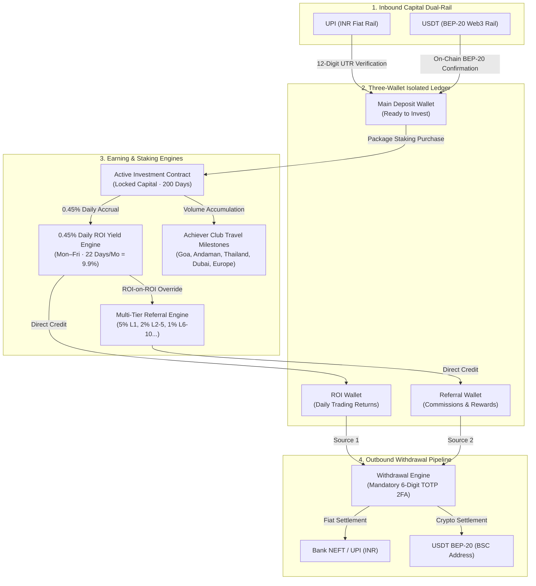
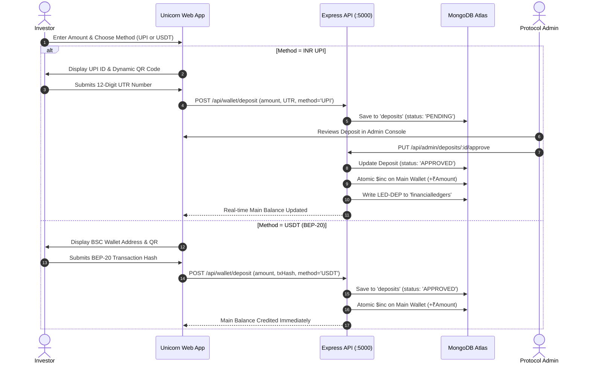
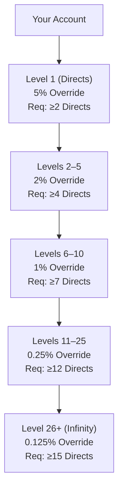
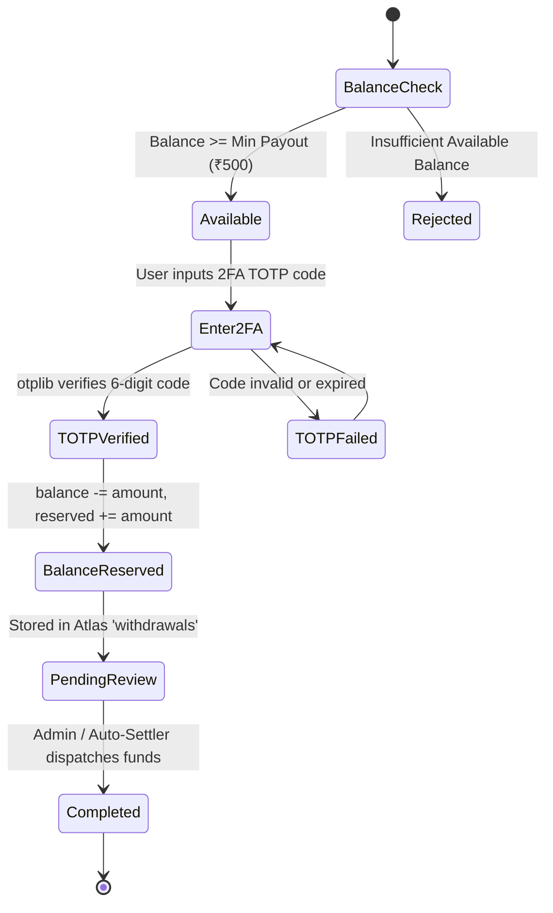
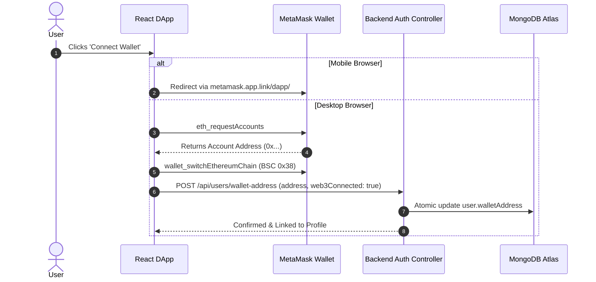
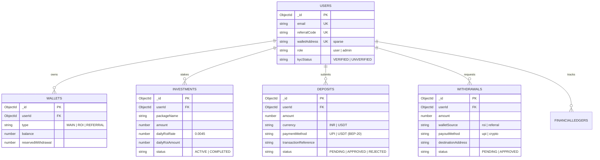

# UNICORN Web3 Platform — Complete End-to-End System Workflow

## 1. Executive Architectural Blueprint

The UNICORN ecosystem is built upon an isolated **Three-Wallet Ledger Architecture**, an automated **0.45% Daily ROI Yield Engine (Mon–Fri)**, a **Dual-Rail Deposit System (INR UPI + BEP-20 USDT)**, a **Multi-Tier Community Override Matrix**, and a **Mandatory 2FA Withdrawal Pipeline**.

---

## 2. Inbound Capital & Dual-Rail Deposit Workflow

### Detailed Rail Logic
1. **Currency & Rail Selection**:
   - The user selects currency: **INR (₹)** or **USD / USDT ($)** (Standard platform peg: $1\text{ USDT} = ₹100\text{ INR}$).
2. **Rail A: INR UPI Dynamic Verification**:
   - The interface generates a dynamic UPI payment QR code and provides the platform VPA (`unicorn@okaxis`).
   - The user completes payment using PhonePe, Google Pay, Paytm, or BHIM.
   - The user enters their 12-digit **UTR / Reference Number**.
   - Submits `POST /api/wallet/deposit` $\rightarrow$ Created in Atlas `deposits` collection with status `PENDING`.
   - Admin approves transaction in Admin Console $\rightarrow$ Credits `MAIN` wallet balance and writes an immutable double-entry record to `financialledgers`.
3. **Rail B: USDT (BEP-20) Smart Contract Rail**:
   - Displays dedicated platform BNB Smart Chain deposit address (`0xAf057...`) and QR code.
   - User transfers USDT from MetaMask, Trust Wallet, or Binance.
   - Submits transaction hash $\rightarrow$ Verified via blockchain scanner $\rightarrow$ Main Deposit Wallet auto-credited.

---

## 3. Package Staking & Daily ROI Engine (0.45% Mon–Fri)

### Mathematical Formulas & Rules
$$\text{Daily Yield Rate } r = 0.45\% = 0.0045$$
$$\text{Daily Return } = \text{Principal} \times 0.0045$$
$$\text{Monthly Yield (22 Trading Days)} = \text{Principal} \times 0.0045 \times 22 = \text{Principal} \times 9.9\%$$

> [!IMPORTANT]
> **Weekend Exclusion Rule**: Trading days strictly operate **Monday through Friday**. Saturday and Sunday are zero-earning pause days. Each contract runs for **200 trading days** (approximately 9 calendar months), reaching $200 \times 0.45\% = 90\%$ total ROI yield + native UNC utility token airdrop.

### Package Tier Matrix

| Package Tier | Investment Amount | Daily Return (0.45%) | Monthly Yield (22 Days, 9.9%) | Native UNC Bonus |
| :--- | :---: | :---: | :---: | :---: |
| **Starter Package** | ₹10,000 ($100) | ₹45 | ₹990 | 1,000 UNC |
| **Basic Growth** | ₹50,000 ($500) | ₹225 | ₹4,950 | 5,000 UNC |
| **Pro Trader** | ₹2,50,000 ($2,500) | ₹1,125 | ₹24,750 | 25,000 UNC |
| **Premium Wealth** | ₹5,00,000 ($5,000) | ₹2,250 | ₹49,500 | 50,000 UNC |
| **Elite Portfolio** | ₹10,00,000 ($10,000) | ₹4,500 | ₹99,000 | 100,000 UNC |
| **Diamond Whale** | ₹25,00,000 ($25,000) | ₹11,250 | ₹2,47,500 | 250,000 UNC |
| **Crown Unicorn** | ₹50,00,000 ($50,000) | ₹22,500 | ₹4,95,000 | 500,000 UNC |

---

## 4. Multi-Level Referral & Achiever Club Incentive Matrix

Referral commissions are calculated on **ROI-on-ROI** (daily earnings of downline members), ensuring zero principal dilution and sustainable tokenomics:

### Achiever Travel Club Milestones
Tracks cumulative 4-month direct business volume:
1. **Goa Trip (3D/2N)**: ₹5,00,000 direct business volume
2. **Andaman Trip (4D/3N)**: ₹15,00,000 direct business volume
3. **Thailand Trip (5D/4N)**: ₹30,00,000 direct business volume
4. **Dubai Grand Tour (5D/4N)**: ₹50,00,000 direct business volume
5. **Europe Luxury Tour (7D/6N)**: ₹1,00,00,000 direct business volume

---

## 5. Mandatory 2FA Withdrawal Pipeline

To ensure absolute capital protection:
- **Source Separation**: Withdrawals are strictly permitted only from **ROI Wallet** or **Referral Wallet**. Staked principal in `MAIN` wallet is locked during contract maturity.
- **Minimum Payout**: ₹500 ($5 USDT).
- **Atomic Balance Reservation**: The requested payout amount is immediately quarantined (`reservedWithdrawal += amount`), blocking concurrent double-spending attempts.
- **Mandatory TOTP 2FA**: The backend rejects any withdrawal request without a verified 6-digit TOTP code generated by Google Authenticator.

---

## 6. Web3 MetaMask Connection Flow

---

## 7. MongoDB Atlas Persistence Model

The live Atlas cluster operates with the following collections:

